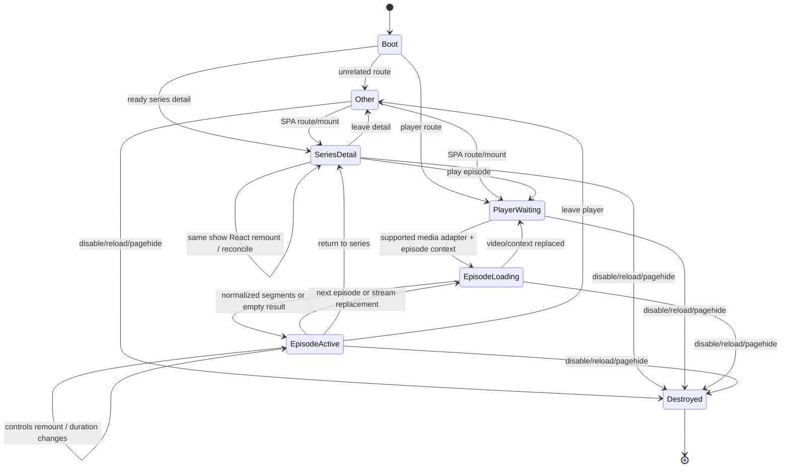

# ShowSkip Architecture

Status: Phase 1.1 contrast fix implemented; packaged load/render user-confirmed; corrected visual recheck pending
Research date: 2026-08-20
Target: Stremio Enhanced for Windows
Artifact: one self-contained `ShowSkip.plugin.js`

## 1. Scope and non-goals

ShowSkip is a Stremio Enhanced UI/player plugin, not a Stremio addon. Phase 1 provides per-series playback-rule configuration for recap, intro, credits, preview, and next-episode behavior; later phases will apply those rules. The configuration surface belongs on each series detail page. Timeline regions will remain visible whenever timestamps and the native seek bar are available, regardless of the selected skip behavior.

Phase 0 contained no production plugin, UI, player mutation, or server component. Phase 1 adds only the standalone plugin foundation and per-show configuration UI described in section 14. The project does not modify Stremio Enhanced, Stremio Web, normal Stremio, Stremio Service, or `server.js`.

## 2. Research baseline

All repository conclusions below are pinned to commits rather than floating branches.

| Reference | Verified revision | Relevant version |
| --- | --- | --- |
| [REVENGE977/stremio-enhanced](https://github.com/REVENGE977/stremio-enhanced) | [`0bb39a4263c26970247128c36d9ef8bd8a3c84ad`](https://github.com/REVENGE977/stremio-enhanced/commit/0bb39a4263c26970247128c36d9ef8bd8a3c84ad), `main`, 2026-06-26 | 1.2.0 |
| [TheIntroDB/stremio-enhanced-plugin](https://github.com/TheIntroDB/stremio-enhanced-plugin) | [`d9e5e4d96ba430f85e456272d3099d03d8ac63cf`](https://github.com/TheIntroDB/stremio-enhanced-plugin/commit/d9e5e4d96ba430f85e456272d3099d03d8ac63cf), `main`, 2026-08-08 | 1.1.4 |
| [Stremio/stremio-web](https://github.com/Stremio/stremio-web) | [`89927a60d104b94ae07486a317edefeb93e4f79a`](https://github.com/Stremio/stremio-web/commit/89927a60d104b94ae07486a317edefeb93e4f79a), `development`, 2026-08-19 | 5.0.0-beta.39 |
| [Stremio/stremio-video](https://github.com/Stremio/stremio-video) | [`607afd84e83ae4260b5ef24a3b328eb3f898cb3c`](https://github.com/Stremio/stremio-video/commit/607afd84e83ae4260b5ef24a3b328eb3f898cb3c), the npm `gitHead` used by current Stremio Web | 0.0.93 |
| [TheIntroDB API reference](https://theintrodb.org/docs) | Live documentation and [OpenAPI 3.0 specification](https://theintrodb.org/openapi.yaml), read 2026-08-20 | API v3.0.0 |

The deployed `https://web.stremio.com/` UI was also inspected on 2026-08-20. Settings reported App Version `6.0.1-beta.09`, Build Version `6ed4463d94baf972dda2630c914ce91c747f9f7c`, and Server Version `4.20.17`. The build string appears in the main asset path, but its linked GitHub tree currently returns 404; it is not treated as a verified Git commit. Pinned source findings and live deployment observations are therefore kept distinct.

Evidence labels used in this document:

- **Source-verified** means current pinned source or first-party API documentation establishes the behavior.
- **Live-verified** means the deployed public Stremio Web DOM was inspected on the research date.
- **Phase validation** means the behavior could not be proven without running inside Stremio Enhanced with a real series stream.

## 3. Stremio Enhanced plugin architecture

### 3.1 File discovery and installation

On Windows, Enhanced resolves the plugin directory to:

```text
%APPDATA%\stremio-enhanced\plugins
```

The fallback when `APPDATA` is absent is `<home>\AppData\Roaming\stremio-enhanced\plugins`. This is defined in [`Properties.ts`](https://github.com/REVENGE977/stremio-enhanced/blob/0bb39a4263c26970247128c36d9ef8bd8a3c84ad/src/core/Properties.ts#L7-L16), and the application creates the directories at startup in [`main.ts`](https://github.com/REVENGE977/stremio-enhanced/blob/0bb39a4263c26970247128c36d9ef8bd8a3c84ad/src/main.ts#L141-L163).

Discovery is non-recursive. Startup loading and the Settings list only consider direct child filenames ending exactly and case-sensitively in `.plugin.js`; see [`initialization.ts`](https://github.com/REVENGE977/stremio-enhanced/blob/0bb39a4263c26970247128c36d9ef8bd8a3c84ad/src/preload/setup/initialization.ts#L54-L67) and [`settingsInjector.ts`](https://github.com/REVENGE977/stremio-enhanced/blob/0bb39a4263c26970247128c36d9ef8bd8a3c84ad/src/preload/ui/settings/settingsInjector.ts#L48-L97).

The supported local workflow is:

1. Copy `ShowSkip.plugin.js` into the plugin directory.
2. Restart Enhanced or press `Ctrl+R`.
3. Open Settings → Enhanced → Plugins and enable ShowSkip.

Enhanced stores enabled filenames in Stremio Web `localStorage` under `enabledPlugins` and reloads enabled files on the next renderer load.

### 3.2 Metadata header

Enhanced parses the first `/** ... */` block in the file. Required keys are `name`, `description`, `author`, and `version`; optional allowlisted keys are `updateUrl`, `source`, `license`, `homepage`, and `requirements`. The parser and lists are authoritative in [`ExtractMetaData.ts`](https://github.com/REVENGE977/stremio-enhanced/blob/0bb39a4263c26970247128c36d9ef8bd8a3c84ad/src/utils/ExtractMetaData.ts#L15-L50) and [`MetaData.ts`](https://github.com/REVENGE977/stremio-enhanced/blob/0bb39a4263c26970247128c36d9ef8bd8a3c84ad/src/interfaces/MetaData.ts#L5-L45).

The current artifact begins with this block, with no earlier JSDoc comment:

```javascript
/**
 * @name ShowSkip
 * @description Per-show segment skipping and next-episode rules for Stremio Enhanced.
 * @updateUrl none
 * @version 0.1.1
 * @author ShowSkip contributors
 */
```

`@updateUrl none` is a security policy, not a temporary placeholder. Enhanced otherwise fetches the URL as plugin source and can overwrite the local file; the `none` guard is in [`ModManager.ts`](https://github.com/REVENGE977/stremio-enhanced/blob/0bb39a4263c26970247128c36d9ef8bd8a3c84ad/src/core/ModManager.ts#L94-L99). ShowSkip will keep updates disabled unless the user explicitly approves a host-managed remote-code exception and a controlled release URL. `@source` and `@license` should be added after the public repository URL and project license are selected. Metadata values are single-line, keys are case-sensitive, unknown keys are ignored, and the first duplicate wins.

There is no metadata permission field, plugin ID, API version, or minimum Enhanced version. `requirements` is used for theme dependencies and is not a permissions mechanism.

### 3.3 Loading and execution

Enhanced reads the full plugin, wraps it in a normal non-async IIFE, creates a lexically scoped `StremioEnhancedAPI`, and appends an inline script whose element ID is the full filename. The source is in [`modController.ts`](https://github.com/REVENGE977/stremio-enhanced/blob/0bb39a4263c26970247128c36d9ef8bd8a3c84ad/src/preload/ui/mod/modController.ts#L15-L61).

Consequences:

- `ShowSkip.plugin.js` receives the settings namespace `ShowSkip`.
- The plugin can manipulate the page DOM and use browser APIs such as `fetch`.
- A bare top-level `await` is invalid despite an example in the current [plugin wiki](https://github.com/REVENGE977/stremio-enhanced/wiki/Plugins); asynchronous startup needs an inner async function or promise chain.
- The loader catches synchronous execution errors only. Later promise/event errors must be handled by ShowSkip.
- No manifest-declared permission model exists. ShowSkip will voluntarily restrict itself to DOM access, the scoped settings/logger API, and direct TheIntroDB segment requests.

### 3.4 Scoped API and storage

The plugin-scoped surface is defined in [`modController.ts`](https://github.com/REVENGE977/stremio-enhanced/blob/0bb39a4263c26970247128c36d9ef8bd8a3c84ad/src/preload/ui/mod/modController.ts#L28-L41):

- `StremioEnhancedAPI.logger.info|warn|error(message)`
- `getSetting(key)`
- `saveSetting(key, value)`
- `registerSettings(schema)`
- `onSettingsSaved(callback)`
- `showAlert(...)`
- `showPrompt(...)`

This lexical facade is a convenience namespace, not a security sandbox. Enhanced also exposes a broader `window.StremioEnhancedAPI`, has no per-plugin permission declarations, and creates its BrowserWindow with `webSecurity: false`, `nodeIntegration: true`, and `contextIsolation: true` in [`main.ts`](https://github.com/REVENGE977/stremio-enhanced/blob/0bb39a4263c26970247128c36d9ef8bd8a3c84ad/src/main.ts#L60-L75). Whether Node globals reach the page-world injected plugin was not live-verified and is irrelevant by design: ShowSkip will use only the lexical facade above, DOM/browser primitives, and direct segment API fetches.

There is no generic plugin storage service. `saveSetting` writes JSON values into:

```text
%APPDATA%\stremio-enhanced\plugins\ShowSkip.plugin.json
```

The implementation reads and rewrites the JSON object for each save. A first `getSetting` call rejects after creating an absent config file; later missing keys resolve to `null`. See [`SettingsApiController.ts`](https://github.com/REVENGE977/stremio-enhanced/blob/0bb39a4263c26970247128c36d9ef8bd8a3c84ad/src/controllers/api/SettingsApiController.ts#L11-L61).

ShowSkip will use `getSetting`/`saveSetting` directly and will not register global Settings controls in Phase 1. This keeps per-show behavior on the series page as required. On the first rejection, the storage adapter retries once because Enhanced may just have created the absent config file; a subsequent `null` is a clean empty store. A repeated rejection is treated as unreadable/corrupt storage: the UI uses in-memory defaults, persistence is disabled for that session, and one warning is logged rather than attempting raw file repair or destructive overwrite.

`registerSettings` and `onSettingsSaved` are deliberately avoided. The former accepts only input/toggle/select schemas and its process-lifetime registration can conflict after a renderer reload; the latter has no unsubscribe and delivers the whole config after replacing prior listeners for that plugin channel. Those behaviors are documented in [`settings.ts`](https://github.com/REVENGE977/stremio-enhanced/blob/0bb39a4263c26970247128c36d9ef8bd8a3c84ad/src/preload/api/settings.ts) and [`SettingsApiController.ts`](https://github.com/REVENGE977/stremio-enhanced/blob/0bb39a4263c26970247128c36d9ef8bd8a3c84ad/src/controllers/api/SettingsApiController.ts).

Profile mutations will run through one serialized read/validate/update/save queue. Main-process file writes are synchronous, but renderer calls are asynchronous; serialization prevents an older plugin-side `state_v1` snapshot from overwriting a newer panel change.

### 3.5 Disable and cleanup limitations

Enhanced has no plugin unload callback. Disabling removes only the injected script node and the enabled filename; already-created listeners, observers, timers, styles, and DOM survive until reload. See the loader removal in [`modController.ts`](https://github.com/REVENGE977/stremio-enhanced/blob/0bb39a4263c26970247128c36d9ef8bd8a3c84ad/src/preload/ui/mod/modController.ts#L64-L71); the Settings UI separately warns that a reload is required at [lines 255–276](https://github.com/REVENGE977/stremio-enhanced/blob/0bb39a4263c26970247128c36d9ef8bd8a3c84ad/src/preload/ui/mod/modController.ts#L255-L276).

Host operations differ:

- **Disable:** removes the injected script node, so ShowSkip's node-removal observer can opportunistically destroy the running instance; reload remains the documented fallback.
- **Uninstall:** removes the `.plugin.js` file and enabled entry but not the already-injected script node; the current instance can remain active until pagehide/reload. The generated `ShowSkip.plugin.json` is retained. See [`ModManager.ts`](https://github.com/REVENGE977/stremio-enhanced/blob/0bb39a4263c26970247128c36d9ef8bd8a3c84ad/src/core/ModManager.ts#L70-L80).
- **Update:** overwrites the plugin file but does not re-execute the running instance; the new code starts after reload. See [`modController.ts`](https://github.com/REVENGE977/stremio-enhanced/blob/0bb39a4263c26970247128c36d9ef8bd8a3c84ad/src/preload/ui/mod/modController.ts#L279-L284).

ShowSkip will still be designed for reversible cleanup:

- keep one global singleton (`window.__showSkipPlugin`);
- destroy an older singleton before starting a new one;
- locate the loader script with `document.getElementById('ShowSkip.plugin.js')`, observe its parent, and call `destroy()` opportunistically if that exact node is removed;
- destroy on `pagehide`/`beforeunload`;
- store references for every listener, observer, timeout, animation frame, and injected node;
- abort active provider requests on context changes.

Script-removal teardown must be live-tested in Enhanced. Uninstall/update limitations cannot be repaired by plugin code; reload remains the host-supported boundary.

## 4. TheIntroDB provider contract

### 4.1 Current read API

The primary endpoint is a direct client-side request:

```text
GET https://api.theintrodb.org/v3/media
```

The current first-party [API reference](https://theintrodb.org/docs) and [OpenAPI specification](https://theintrodb.org/openapi.yaml) establish:

- identify media with one of `tmdb_id`, `tvdb_id`, or `imdb_id`;
- TMDB is preferred by the API, with priority `tmdb_id` → `tvdb_id` → `imdb_id` if more than one is supplied;
- TV lookups also require integer `season` and `episode` values starting at 1;
- `duration_ms` is optional and asks the service to select the closest known release version;
- anonymous reads need no authentication and include accepted submissions;
- a successful body contains `tmdb_id`, `type`, optional `season`/`episode`, and zero or more arrays named `intro`, `recap`, `credits`, and `preview`;
- v3 has no `postCredits` or post-credit-scene field. `preview` remains a preview and is never relabeled as post-credit content;
- each array item has nullable integer `start_ms` and `end_ms`;
- the read schema explicitly calls out a null intro start; submission business rules also allow recap null/zero as beginning-of-media, so ShowSkip defensively accepts that cross-section-compatible form; credits/preview may end at `null` (end of media);
- zero has type-specific sentinel meaning: an intro/recap may legitimately start at zero, but a credits/preview start of zero means no segment; an end of zero means no segment for every type;
- absent segment types are omitted;
- the current OpenAPI schema does not promise confidence or submission counts, although the [current official client tolerates similarly named fields](https://github.com/TheIntroDB/theintrodb-npm/blob/842937ffd825bb79284ad8a1ee78a79068abc7fc/src/funcs.ts#L413-L473). ShowSkip will not trust undocumented fields: the normalized slots remain `null` until a documented contract defines their names, types, and ranges;
- 400 is an invalid request, 404 is no accepted media data, 429 is a rate/usage limit, and 500 is a server failure.

The OpenAPI document states an anonymous `GET /media` usage limit of 500 requests per IP per day and an endpoint rate limit of 30 requests per 10 seconds. ShowSkip therefore needs request deduplication, an in-memory session cache, aborts, and restrained retry behavior. A short endpoint-rate limit and an exhausted daily usage allowance are different states even though both use HTTP 429.

The [live endpoint was sampled](https://api.theintrodb.org/v3/media?imdb_id=tt0903747&season=1&episode=1) on 2026-08-20. It returned `tmdb_id: 1396`, `type: tv`, season/episode 1/1, an intro range, and credits with `end_ms: null`. The production plugin must validate every response rather than assume the sample. The current OpenAPI does not specify 204, but the official plugin treats 204 like no data; ShowSkip will tolerate it as an empty legacy response while treating 404 as the current negative result.

Fetch policy is deliberately bounded: require the observed media duration to be finite and greater than zero, wait for a tested 750 ms quiet window after duration changes, round it to a positive safe integer, and send that exact value as `duration_ms` with `Accept: application/json` and no API key. Deduplicate by the canonical request URL and key the small in-memory session LRU by provider, canonical episode identity, the exact normalized `duration_ms`, and auth mode; a coarse duration bucket could select timestamps for a different release cut. Permit at most two distinct duration-key lookups per media-source/context token; a source replacement creates a new token, while further jitter fails closed instead of spending quota. Cache only validated 200 results and explicit 404/legacy-204 negative results—never aborts, malformed bodies, 429s, network failures, or 5xx responses. Abort on context-token changes. A transient network error or 5xx may receive a short capped retry. A short rate-limit 429 may receive at most one bounded retry only when a numeric `X-RateLimit-Reset` value validates and fits the cap; `code: usage_limit_exceeded`, usage-limit headers, or a long/human-readable body `retry_after` make the request terminal for the session. Other 4xx responses are terminal. No response is allowed to update a controller whose episode/context token is no longer current.

### 4.2 Findings from the official Enhanced plugin

The current TheIntroDB plugin is distributed under [GPL-3.0](https://github.com/TheIntroDB/stremio-enhanced-plugin/blob/d9e5e4d96ba430f85e456272d3099d03d8ac63cf/LICENSE#L1) and is a behavioral reference, not a code template. Its current implementation:

- uses API v3 and four types at [`tidb.plugin.js` lines 14–58](https://github.com/TheIntroDB/stremio-enhanced-plugin/blob/d9e5e4d96ba430f85e456272d3099d03d8ac63cf/tidb.plugin.js#L14-L58);
- reconciles DOM/player changes with a body `MutationObserver` plus a two-second interval at [lines 250–261](https://github.com/TheIntroDB/stremio-enhanced-plugin/blob/d9e5e4d96ba430f85e456272d3099d03d8ac63cf/tidb.plugin.js#L250-L261);
- resolves a URL context and then tries `window.services.core.transport.getState('player')` at [lines 655–668](https://github.com/TheIntroDB/stremio-enhanced-plugin/blob/d9e5e4d96ba430f85e456272d3099d03d8ac63cf/tidb.plugin.js#L655-L668) and [758–781](https://github.com/TheIntroDB/stremio-enhanced-plugin/blob/d9e5e4d96ba430f85e456272d3099d03d8ac63cf/tidb.plugin.js#L758-L781);
- sends IMDb or presumed TMDB identity, season/episode, and HTML video duration to `/media` at [lines 819–838](https://github.com/TheIntroDB/stremio-enhanced-plugin/blob/d9e5e4d96ba430f85e456272d3099d03d8ac63cf/tidb.plugin.js#L819-L838);
- normalizes null starts to zero seconds and keeps null ends at [lines 857–866](https://github.com/TheIntroDB/stremio-enhanced-plugin/blob/d9e5e4d96ba430f85e456272d3099d03d8ac63cf/tidb.plugin.js#L857-L866);
- scopes its marker implementation only to a generic slider selector at [lines 902–918](https://github.com/TheIntroDB/stremio-enhanced-plugin/blob/d9e5e4d96ba430f85e456272d3099d03d8ac63cf/tidb.plugin.js#L902-L918);
- provides explicit media cleanup and singleton replacement at [lines 1109–1157](https://github.com/TheIntroDB/stremio-enhanced-plugin/blob/d9e5e4d96ba430f85e456272d3099d03d8ac63cf/tidb.plugin.js#L1109-L1157).

ShowSkip will independently implement the documented API contract. It will reuse the useful concepts—state-first episode context, duration-aware lookup, normalized segment arrays, reconciliation, and explicit teardown—but will not copy GPL implementation bodies. It will not include the reference plugin's analytics, user-stats request, global settings UI, or remote SVG icon.

The eventual ShowSkip `LICENSE` will cover ShowSkip code only. It will not purport to license or grant redistribution rights to TheIntroDB timestamp data; a separate notice will preserve that code/data distinction. Clean implementation means no copied or cosmetically renamed GPL functions or assets.

### 4.3 Terms, attribution, and caching

[TheIntroDB Terms of Service](https://theintrodb.org/docs/terms), last updated 2026-06-16 when reviewed, limits timestamp data to direct client-side, non-commercial end-user applications. It permits temporary client-side caching for performance but prohibits building, persisting, redistributing, or reconstructing the database. Commercial use requires a separate agreement.

The Terms also state that users are expected to have legal access to the underlying media. ShowSkip neither locates nor grants media access; it operates only on playback already opened by the user.

Architecture consequences:

- every request originates from the user's Enhanced renderer directly to `api.theintrodb.org`;
- segment responses are held only in memory for the playback session and are not written to `ShowSkip.plugin.json`;
- ShowSkip does not scrape, bulk fetch, proxy, mirror, or redistribute timestamps;
- once Phase 2 actually uses provider data, the open per-show panel will voluntarily include unobtrusive “Timestamp data by TheIntroDB” attribution using the destination currently specified by the Terms, `https://theintrodb.com`. Attribution is requested but not required by default; written notice can make it required on 14 days' notice. A panel that disappears when closed is not assumed to satisfy a future mandatory-attribution notice, so placement and the `.com`/official `.org` discrepancy must both be rechecked before release;
- the release remains non-commercial unless separate terms are obtained.

## 5. Stremio Web context and DOM findings

### 5.1 Routes and identifiers

Current route definitions are source-verified in [`routerPaths.tsx`](https://github.com/Stremio/stremio-web/blob/89927a60d104b94ae07486a317edefeb93e4f79a/src/router/routerPaths.tsx#L33-L54) and [`routesRegexp.js`](https://github.com/Stremio/stremio-web/blob/89927a60d104b94ae07486a317edefeb93e4f79a/src/common/routesRegexp.js#L31-L47):

```text
#/detail/:type?/:id?/:videoId?
#/metadetails/:type?/:id?/:videoId?
#/player/:stream/:streamTransportUrl?/:metaTransportUrl?/:type?/:id?/:videoId?
```

The leading `#` is the browser form because the app uses `HashRouter` in [`src/index.js`](https://github.com/Stremio/stremio-web/blob/89927a60d104b94ae07486a317edefeb93e4f79a/src/index.js#L14-L56); route parsing must decode individual segments defensively and reject malformed encodings rather than decoding the whole hash as one value.

The series detail route's `id` is the show/meta ID; optional `videoId` identifies the selected episode. [`MetaDetails.js`](https://github.com/Stremio/stremio-web/blob/89927a60d104b94ae07486a317edefeb93e4f79a/src/routes/MetaDetails/MetaDetails.js#L20-L24) receives all three values and passes the ready meta ID into `MetaPreview` at [lines 174–195](https://github.com/Stremio/stremio-web/blob/89927a60d104b94ae07486a317edefeb93e4f79a/src/routes/MetaDetails/MetaDetails.js#L174-L195), but [`MetaPreview` does not consume that prop](https://github.com/Stremio/stremio-web/blob/89927a60d104b94ae07486a317edefeb93e4f79a/src/components/MetaPreview/MetaPreview.js#L28-L29) or render it into a stable DOM attribute. ShowSkip therefore parses the route rather than inferring identity from visible titles.

Canonical show key policy:

1. If the decoded series `id` matches `^tt[0-9]{7,}$`, store `imdb:<lowercase id>`.
2. Otherwise store `stremio:series:<percent-encoded exact id>`.
3. Never use the episode `videoId` as the profile key.

For player context, prefer a ready player state containing meta ID plus `seriesInfo.season` and `seriesInfo.episode`. Route fallback is accepted only when the decoded `videoId` ends in an anchored `:<positive season>:<positive episode>` suffix **and** the exact remaining prefix equals the decoded route `id`; otherwise identity fails closed. This handles route IDs that themselves contain colons without treating arbitrary trailing numbers as episode proof. Canonical profile identity and provider eligibility are separate: the current TheIntroDB contract accepts only `^tt[0-9]{7,8}$`, so a longer valid IMDb-style profile ID remains usable for preferences but the provider declines it until its API supports that form. A non-IMDb Stremio profile ID is likewise stable for preferences but is not automatically a valid TheIntroDB TMDB ID.

### 5.2 Series action row

Source order in [`MetaPreview.js`](https://github.com/Stremio/stremio-web/blob/89927a60d104b94ae07486a317edefeb93e4f79a/src/components/MetaPreview/MetaPreview.js#L210-L276) is Trailer, the library/watched action group, optional Show, optional ratings, and optional Share. Native action buttons are circular and use theme variables in [`ActionButton/styles.less`](https://github.com/Stremio/stremio-web/blob/89927a60d104b94ae07486a317edefeb93e4f79a/src/components/MetaPreview/ActionButton/styles.less#L5-L41). The containing row's layout is in [`MetaPreview/styles.less`](https://github.com/Stremio/stremio-web/blob/89927a60d104b94ae07486a317edefeb93e4f79a/src/components/MetaPreview/styles.less#L156-L224).

Live deployment validation on `#/detail/series/tt9288030` found this hierarchy:

```text
metadetails container
└─ metadetails content
   └─ meta preview
      └─ action buttons row
         ├─ Trailer
         ├─ library/watched ActionsGroup
         └─ Share
```

The deployed hashed class names are evidence only and must not be hard-coded. No stable ID, test attribute, role, or accessible label exists on the row itself.

Chosen insertion strategy:

- activate only when the parsed route is `detail|metadetails`, type is `series`, and the meta preview is ready;
- locate the active meta detail root and meta preview structurally, using the centralized `action-buttons-container-` CSS-module token prefix only at this final DOM boundary;
- locate the direct action-row child of that active meta preview;
- append one ShowSkip launcher as the final action-row child rather than depending on Trailer text, localization, native child count, or a specific sibling;
- tag all owned nodes with stable `data-showskip-*` attributes and reconcile idempotently after React remounts;
- visually match the current circular control using Stremio CSS variables and an inline SVG, not by cloning a native element or fetching an icon.

Appending is the least fragile current placement and keeps the launcher next to Trailer/library/watched/share. Exact prefix selectors and responsive placement require Phase 1 validation inside Enhanced.

### 5.3 Video element and seek bar

The current player renders a container into which `@stremio/stremio-video` mounts the selected implementation; the outer component is in [`Video.js`](https://github.com/Stremio/stremio-web/blob/89927a60d104b94ae07486a317edefeb93e4f79a/src/routes/Player/Video/Video.js#L7-L13). The exact selector precedence in pinned [`selectVideoImplementation.js`](https://github.com/Stremio/stremio-video/blob/607afd84e83ae4260b5ef24a3b328eb3f898cb3c/src/StremioVideo/selectVideoImplementation.js#L14-L68) matters:

1. A missing stream or `externalUrl` selects no in-page implementation.
2. A connected Chromecast wins next.
3. A `ytId` selects a YouTube implementation: desktop uses `YouTubeVideo`, while Tizen/webOS use `YouTubeIFrameVideo`.
4. Only then does `shellTransport` select MPV-backed `ShellVideo`, which creates no HTML media element.
5. Otherwise a `streamingServerURL`, then a supported direct `stream.url`, selects the applicable platform implementation; on Enhanced Windows this is wrapped `HTMLVideo`.

Stremio Enhanced is a different Electron wrapper from the official Windows shell. Its pinned source loads `https://web.stremio.com/` and, on Windows, lets the user supply a local streaming backend through Stremio Service or managed `server.js`; see [`main.ts` lines 91–125](https://github.com/REVENGE977/stremio-enhanced/blob/0bb39a4263c26970247128c36d9ef8bd8a3c84ad/src/main.ts#L91-L125) and [lines 167–187](https://github.com/REVENGE977/stremio-enhanced/blob/0bb39a4263c26970247128c36d9ef8bd8a3c84ad/src/main.ts#L167-L187). It does not supply the official WebView2 shell transport, which current Stremio Web recognizes through [`useShell.ts`](https://github.com/Stremio/stremio-web/blob/89927a60d104b94ae07486a317edefeb93e4f79a/src/common/Platform/shell/useShell.ts#L4-L6). ShowSkip touches neither streaming backend.

It is therefore a source-supported inference—not yet a target-runtime observation—that ordinary built-in playback in Enhanced 1.2.0 exposes an HTML `<video>`. Live public-web validation with a public-domain stream showed `<video playsinline>` under the current player container, and the official TheIntroDB Enhanced plugin relies on the same path. Stremio itself scopes HTML-media lookup through its video host at [`Player.js` lines 92–98](https://github.com/Stremio/stremio-web/blob/89927a60d104b94ae07486a317edefeb93e4f79a/src/routes/Player/Player.js#L92-L98). Phase 2 must still confirm this inside Enhanced.

The assumption has explicit limits: YouTube, Chromecast, external-player, and any future shell-backed path may not expose `<video>`. A live YouTube trailer rendered an iframe and no page-level video. ShowSkip will capability-detect the current medium and use an `HtmlVideoAdapter` only when exactly one connected, visible video with a real `currentSrc` is found under the active native player host. Zero or multiple eligible candidates fail closed. Features gate independently: provider selection/markers require a finite duration greater than zero, button/auto rules require an observed clock plus safe seek, and automatic rules require sufficiently precise events. Missing capabilities fail closed for the affected features.

Enhanced's optional MPV/VLC setting is a separate external-process flow, not Stremio Web's `ShellVideo`. When enabled, Enhanced backs out of the built-in player before launching the external executable in [`externalPlayerInterceptor.ts`](https://github.com/REVENGE977/stremio-enhanced/blob/0bb39a4263c26970247128c36d9ef8bd8a3c84ad/src/preload/ui/externalPlayerInterceptor.ts#L15-L50). The scoped plugin API supplies no external-player clock, duration, subscription, or seek surface. ShowSkip therefore provides no on-page markers or skipping in external-player mode. It will not attempt raw MPV IPC, React internals, or synthetic seek-bar dragging.

For the supported path, `HTMLVideo` creates and attaches the element in [`HTMLVideo.js` lines 18–100](https://github.com/Stremio/stremio-video/blob/607afd84e83ae4260b5ef24a3b328eb3f898cb3c/src/HTMLVideo/HTMLVideo.js#L18-L100), and Stremio's own abstraction seeks by assigning `currentTime` after converting milliseconds to seconds at [lines 415–418](https://github.com/Stremio/stremio-video/blob/607afd84e83ae4260b5ef24a3b328eb3f898cb3c/src/HTMLVideo/HTMLVideo.js#L415-L418). ShowSkip may use the equivalent DOM operation only through its scoped adapter and must verify that Stremio UI/resume state follows it during Phase 2/3 testing.

The seek bar renders a `Slider` between time labels in [`SeekBar.js`](https://github.com/Stremio/stremio-web/blob/89927a60d104b94ae07486a317edefeb93e4f79a/src/routes/Player/ControlBar/SeekBar/SeekBar.js#L44-L69). The slider owns four absolute layers: base track, buffered track, played/masked track, and thumb; see [`Slider.js`](https://github.com/Stremio/stremio-web/blob/89927a60d104b94ae07486a317edefeb93e4f79a/src/components/Slider/Slider.js#L134-L153) and [`Slider/styles.less`](https://github.com/Stremio/stremio-web/blob/89927a60d104b94ae07486a317edefeb93e4f79a/src/components/Slider/styles.less#L19-L92). CSS modules compile with generated suffixes, so those suffixes are never selectors; see [`webpack.config.js`](https://github.com/Stremio/stremio-web/blob/89927a60d104b94ae07486a317edefeb93e4f79a/webpack.config.js#L91-L98).

Live validation confirmed that seek and volume controls share the same slider class. Therefore a global “first slider” selector is unsafe.

Chosen marker anchor:

```text
current player container
└─ current control bar
   └─ seek-bar container
      └─ slider container   ← ShowSkip overlay host
```

The timeline renderer will add one `pointer-events: none`, `aria-hidden` overlay to the seek slider only, immediately before the native final/thumb layer so regions paint over the track but below the thumb. Marker geometry is calculated only after guarding that `actualDurationMs` is finite and greater than zero, then uses `effectiveStartMs / actualDurationMs` and `(effectiveEndMs - effectiveStartMs) / actualDurationMs`, clamped to `[0, 100]`. A single passive slider `pointermove` handler can calculate hover time and display a small plugin tooltip without giving markers pointer events or blocking native seeking.

Markers will use subtle type colors, no permanent labels, and the native track height. Because the overlay lives inside the control bar, native control visibility automatically governs marker visibility. A `ResizeObserver`, `durationchange`, segment-result update, and DOM reconcile redraw it after layout or React remounts.

### 5.4 Player state and next episode

The official player model includes `metaItem`, `seriesInfo`, and `nextVideo`; see [`Player.d.ts`](https://github.com/Stremio/stremio-web/blob/89927a60d104b94ae07486a317edefeb93e4f79a/src/core/types/models/Player.d.ts#L53-L65). It does not expose the live media clock, duration, or pause state; core state is for identity/bookkeeping, not a replacement for `PlaybackAdapter`.

The current TheIntroDB plugin tries `window.services.core.transport.getState('player')`. Enhanced's own internal playback helper instead probes direct `core.getState('player')` after finding `window.core || window.services?.core` in [`PlaybackState.ts`](https://github.com/REVENGE977/stremio-enhanced/blob/0bb39a4263c26970247128c36d9ef8bd8a3c84ad/src/utils/PlaybackState.ts#L32-L57) and [`Helpers.ts`](https://github.com/REVENGE977/stremio-enhanced/blob/0bb39a4263c26970247128c36d9ef8bd8a3c84ad/src/utils/Helpers.ts#L165-L238). That helper is internal, is not in the scoped plugin API, and uses dynamic evaluation, so ShowSkip will not copy or depend on it. It also documents that the live core global may disappear during playback. Phase 2 may capture and bind a validated `getState` method as soon as one of the known shapes appears, without replacing host globals or using `eval`; reads remain bounded, shape-checked, and route-cross-checked. Ordinary deployed Stremio Web did not expose `window.services` during live browser inspection, so exact Enhanced availability remains mandatory live validation.

Core seek dispatch alone is not media control: current Stremio Web performs both private `video.setTime(time)` and core `seek(...)` in [`Player.js`](https://github.com/Stremio/stremio-web/blob/89927a60d104b94ae07486a317edefeb93e4f79a/src/routes/Player/Player.js#L266-L269). ShowSkip will seek only through a verified playback adapter and let Stremio's own media events update UI/resume state; Phase 3 must verify that propagation in Enhanced.

Stremio's next-video implementation is source-verified:

1. Dispatch `Player → NextVideo` to the player model in [`usePlayer.js`](https://github.com/Stremio/stremio-web/blob/89927a60d104b94ae07486a317edefeb93e4f79a/src/routes/Player/usePlayer.js#L149-L157).
2. Navigate with replacement to `nextVideo.deepLinks.player`, or fall back to `deepLinks.metaDetailsStreams`, in [`Player.js`](https://github.com/Stremio/stremio-web/blob/89927a60d104b94ae07486a317edefeb93e4f79a/src/routes/Player/Player.js#L194-L225).
3. The native control-bar next button calls the same callback when `nextVideo` exists; see [`ControlBar.js`](https://github.com/Stremio/stremio-web/blob/89927a60d104b94ae07486a317edefeb93e4f79a/src/routes/Player/ControlBar/ControlBar.js#L87-L91) and [lines 135–145](https://github.com/Stremio/stremio-web/blob/89927a60d104b94ae07486a317edefeb93e4f79a/src/routes/Player/ControlBar/ControlBar.js#L135-L145).
4. The fixed `playNext` shortcut is [`Shift+N`](https://github.com/Stremio/stremio-web/blob/89927a60d104b94ae07486a317edefeb93e4f79a/src/common/Shortcuts/shortcuts.json#L112-L116); its current handler performs the same guarded dispatch and deep-link navigation at [`Player.js` lines 781–788](https://github.com/Stremio/stremio-web/blob/89927a60d104b94ae07486a317edefeb93e4f79a/src/routes/Player/Player.js#L781-L788). The document shortcut handler currently has no `isTrusted` requirement in [`Shortcuts.tsx`](https://github.com/Stremio/stremio-web/blob/89927a60d104b94ae07486a317edefeb93e4f79a/src/common/Shortcuts/Shortcuts.tsx#L37-L82).

The core `NextVideo` action also updates seek-history/library state before navigation, as shown in the pinned core used by current Stremio Web at [`player.rs` lines 695–735](https://github.com/Stremio/stremio-core/blob/474ffaa42e0b7b9bcba0dd99368c41e828579dec/src/models/player.rs#L695-L735). This is why route construction alone is not an acceptable fallback.

Chosen safety order for Phase 3:

1. Establish next availability through either a shape-validated `player.nextVideo` from the captured core state or an unambiguously identified mounted native next control. Never infer it from episode numbering.
2. Use a host-supported single next action if Phase 3 discovers and validates one in the Enhanced page world.
3. Otherwise use the app's source-verified `Shift+N` shortcut only after Phase 3 confirms synthetic key handling in Enhanced, the player route is focused, no input/modal is active, and exactly one core-aware transition occurs. Until that test passes, the synthetic path is disabled.
4. Use the unambiguously identified mounted native next control as a fallback when it is the availability proof; never select it by translated text or a generated class suffix.
5. If availability or every action path is unvalidated, do nothing and log one warning. Do not reproduce private navigation by guessing a URL or synthesizing an episode number.

This path must be tested in Enhanced with a real multi-episode series before any automatic next behavior is enabled.

## 6. Proposed architecture

The shipped file is a single bundle, but its source will retain six explicit responsibilities.

| Component | Responsibility | Must not do |
| --- | --- | --- |
| `ContextDetector` | Parse routes, observe SPA mounts, resolve show/player/episode context | Fetch segments or render UI |
| `ProfileStore` | Validate defaults, migrate, cache, and persist per-show profiles | Persist provider timestamps |
| `SegmentProvider` / `TheIntroDBProvider` | Fetch, validate, and normalize episode segments | Touch player DOM or apply rules |
| `ShowPageController` | Launcher, fully removable panel, profile editing | Control playback |
| `TimelineRenderer` | Seek-bar overlay and hover tooltip | Decide skip behavior |
| `PlayerController` | Playback-adapter lifecycle, buttons, auto-skip session state, next episode | Parse series-page UI |

`PlayerController` depends on a narrow `PlaybackAdapter`; Phase 2 implements `HtmlVideoAdapter`, while an unsupported implementation fails closed. This boundary leaves room for a future host-supported shell adapter without leaking player mechanics into rule logic. Shared helpers cover logging, abortable delays, owned DOM/style creation, validation, and teardown registration.

### 6.1 Lifecycle state machine



One document-level MutationObserver watches child-list changes and schedules a coalesced reconcile with one animation frame. `hashchange` schedules the same reconcile. Route/media transitions may open a short, abortable retry window for late core state or DOM, but there is no permanent polling interval. Context transitions synchronously tear down the old controller before mounting the new one.

The parsed `location.hash` is the authority for which controller may be active; DOM presence is not. Stremio deliberately retains lower-index route views while a higher-index view is open in [`Routes.tsx`](https://github.com/Stremio/stremio-web/blob/89927a60d104b94ae07486a317edefeb93e4f79a/src/router/Routes.tsx#L21-L86), and live validation confirmed that a prior detail page remains mounted beneath the player. Every query is therefore route-gated and scoped to the active route root. Entering the player tears down the detail launcher/panel even if their former React ancestors remain connected.

### 6.2 Context model

```javascript
{
  route: {
    kind: "seriesDetail" | "player" | "other",
    type: "series" | null,
    metaId: "tt9288030" | null,
    videoId: "tt9288030:1:1" | null
  },
  show: {
    key: "imdb:tt9288030",
    stremioId: "tt9288030",
    imdbId: "tt9288030",
    tmdbId: null
  },
  episode: {
    key: "imdb:tt9288030:s1:e1",
    season: 1,
    episode: 1,
    stremioVideoId: "tt9288030:1:1"
  },
  playback: {
    adapterKind: "htmlVideo" | null,
    mediaElement: null,
    actualDurationMs: null,
    streamKey: null,
    nextVideo: null
  }
}
```

Identity values from state and route must agree when both exist. A disagreement means the context is transitioning; defer rather than fetching for the wrong episode.

### 6.3 Persistent profile model

One Enhanced setting key, `state_v1`, stores only preferences:

```javascript
{
  schemaVersion: 1,
  profiles: {
    "imdb:tt9288030": {
      version: 1,
      showId: "imdb:tt9288030",
      intro: "button",
      recap: "button",
      credits: "button",
      preview: "button",
      nextEpisode: "stremio",
      panelOpen: true
    }
  },
  corrections: {}
}
```

Allowed values are checked on every read. Missing or invalid fields fall back individually rather than discarding an entire profile. Unknown fields are retained to make forward migration possible. Defaults are exactly:

```javascript
{
  recap: "button",
  intro: "button",
  credits: "button",
  preview: "button",
  nextEpisode: "stremio",
  panelOpen: true
}
```

The top-level value and each profile must be plain JSON objects. Phase 1 will define tested profile-count and serialized-size ceilings; an over-limit value becomes read-only/in-memory for the session rather than being traversed without bound or silently overwritten.

Closing the panel immediately removes the entire panel node and persists `panelOpen: false`. Reopening from the launcher persists `true`. When closed, no header, pill, summary, menu, backdrop, or panel fragment remains; the launcher is the only ShowSkip element on the series page.

The reserved `corrections` object supports future episode/stream timing adjustment without redesigning profiles:

```javascript
{
  "imdb:tt9288030:s1:e1": {
    byStream: {
      "sha256-of-stable-stream-metadata": {
        offsetMs: 1250,
        updatedAt: "2026-08-20T00:00:00.000Z"
      }
    }
  }
}
```

No correction UI or fingerprint matcher is planned in Phase 1.

### 6.4 Normalized segment model

The provider-neutral type vocabulary is extensible: `intro | recap | credits | preview | postCredits`. The current TheIntroDB provider maps only its four documented arrays one-to-one and never emits `postCredits`; that value is reserved for a future provider that truly distinguishes post-credit scenes. A future separate playback preference will require an explicit profile-schema migration rather than silently reusing `preview`.

```javascript
{
  episodeKey: "imdb:tt9288030:s1:e1",
  provider: {
    id: "theintrodb",
    apiVersion: 3,
    fetchedAt: "2026-08-20T00:00:00.000Z",
    mediaId: { scheme: "imdb", value: "tt9288030" },
    confidence: null
  },
  timing: {
    providerDurationHintMs: 2940000,
    actualDurationMs: 2940000,
    offsetMs: 0,
    offsetSource: "none"
  },
  segments: [
    {
      id: "theintrodb:intro:0:62000:91000",
      type: "intro",
      providerStartMs: 62000,
      providerEndMs: 91000,
      effectiveStartMs: 62000,
      effectiveEndMs: 91000,
      confidence: null,
      submissionCount: null,
      source: "theintrodb"
    }
  ]
}
```

The current v3 OpenAPI response does not promise per-segment confidence, submission count, or the selected release duration. Undocumented confidence/submission-like response fields are ignored and the reserved normalized slots remain `null`; a future documented provider contract can populate them through explicit validation. `providerDurationHintMs` records the exact positive integer duration sent with the request, while `actualDurationMs` records the current video. Raw nullable provider boundaries are retained; effective times apply the documented null-boundary semantics, optional correction, and clamp to the actual duration.

Provider interface:

```javascript
SegmentProvider.fetchEpisode(context, { signal })
  // -> Promise<NormalizedSegmentBundle>
```

Provider output validation rules:

- require a plain response object with `type === "tv"` and positive safe-integer `tmdb_id`; because current OpenAPI makes response `season`/`episode` optional, validate each returned value as a positive safe integer equal to the requested current episode when present, and otherwise rely on the exact request plus context token. This is an explicit availability tradeoff rather than pretending the optional fields are guaranteed;
- when the request used canonical TMDB identity, require the returned `tmdb_id` to match; an IMDb lookup may legitimately resolve to a TMDB ID, so it is checked for validity but not equality to an unavailable value;
- accept each known segment property only when absent or an array within a conservative item-count bound; any envelope identity mismatch rejects the response and prevents caching;
- in `TheIntroDBProvider`, accept only its four documented types and map them one-to-one;
- require each item to own both `start_ms` and `end_ms`; each raw value must be `null` or a non-negative safe integer no greater than the documented 21,600,000 ms timestamp ceiling;
- apply raw sentinel rules *before* expanding any null: for intro/recap, require `end_ms > 0`, require start `null` or non-negative, and require end greater than `start_ms ?? 0`; reject a null end;
- for credits/preview, require `start_ms > 0`; allow end only when it is `null` or `> 0`, and require a finite end to exceed start;
- reject all `end_ms === 0` values as no-segment sentinels; never treat zero as “to media end”;
- for finite-ended raw segments, enforce the submission-rule duration bounds before correction: intro 5–200 seconds, recap 5–1,200 seconds, and credits/preview 5–1,800 seconds. Null-ended credits/preview are handled separately rather than assigned a fabricated finite provider interval;
- only after acceptance and once `actualDurationMs` is finite and greater than zero, normalize intro/recap null starts to zero and resolve a credits/preview null end to actual duration for effective rendering/playback while retaining the raw null; until then a terminal segment is non-actionable;
- drop or clamp effective ranges outside that positive actual duration and drop `end <= start` after correction;
- retain multiple segments per type;
- sort by start, then end;
- do not merge distinct regions merely because they share a type.

These rules come from the live OpenAPI's named `components.schemas.SegmentTimestamp` and `SubmissionData` schemas plus the `/submit` business rules, read on the research date. The current official plugin's raw-positive-endpoint filter corroborates the need to reject sentinels before normalization at [`tidb.plugin.js` lines 857–868](https://github.com/TheIntroDB/stremio-enhanced-plugin/blob/d9e5e4d96ba430f85e456272d3099d03d8ac63cf/tidb.plugin.js#L857-L868). ShowSkip's per-type validation is intentionally stricter than that generic filter.

AniSkip can later implement the same interface without leaking its schema into player or UI code.

### 6.5 Show-page UI

The launcher is one accessible circular button with an inline skip/settings SVG, `title`, `aria-label`, keyboard activation, and Stremio theme variables. It is appended to the current series action row and tagged `data-showskip-launcher`.

The panel is a body-level portal anchored to the launcher with viewport clamping. A portal avoids placing a complex subtree inside React-owned children. A resize observer and scroll/resize listener reposition it. On narrow layouts it becomes a constrained bottom sheet while remaining part of the series page.

Panel content:

- four compact rows: Recap, Intro, Credits, Preview;
- each row has `Auto`, `Button`, and `Off` choices;
- one Next Episode row with `At credits`, `After credits`, `Button`, `Stremio default`, and `Never`;
- one close control that removes the entire panel;
- once Phase 2 uses provider data, small voluntary TheIntroDB attribution in the open panel footer, subject to the release-time Terms recheck above.

There are no global behavior controls in Enhanced Settings during Phase 1.

### 6.6 Timeline renderer

The timeline is behavior-independent. If a valid bundle exists and duration is finite and greater than zero, all normalized regions render even when the matching profile behavior is `none`/Off.

Type palette should be subtle and distinguishable in both dark and glass themes:

- recap: warm amber;
- intro: gold;
- credits: cool blue;
- preview: green.

Each region is track-height, percent-positioned, rounded, semi-transparent, and unlabeled. Slider hover computes the pointed timestamp and shows a temporary tooltip such as `Intro · 01:02–01:31`. The tooltip is removed when controls, slider, episode, or plugin context disappears.

### 6.7 Playback rules

Rule logic uses only this capability contract:

```javascript
PlaybackAdapter = {
  kind,
  capabilities: {
    canObserveTime,
    canObserveDuration,
    clockPrecisionMs
  },
  getTimeMs(),
  getDurationMs(),
  canSeekToMs(value),
  seekToMs(value, { signal }), // Promise<{ mediaPositionReached: boolean }>
  subscribe(listener),
  destroy()
}
```

The Phase 2 `HtmlVideoAdapter` wraps exactly one eligible connected, visible `<video>` beneath the active native player host. It listens to `loadedmetadata`, `durationchange`, `timeupdate`, `seeking`, `seeked`, `play`, `emptied`, and `ended` as needed and converts seconds to integer milliseconds at the boundary. It never controls an arbitrary document video. `canSeekToMs(value)` is target-specific: the finite target must be contained in a current `video.seekable` range; duration or `currentSrc` alone does not prove seekability. `seekToMs` aborts on adapter replacement/context change and resolves success only when `seeked` or a subsequent media-time sample reaches the target tolerance.

That result proves only the media position. It does not prove Stremio's UI, resume offset, seek history, and library bookkeeping synchronized. Direct-seek propagation in packaged Enhanced is a Phase 3 release gate: skip buttons and auto rules remain disabled until it passes, while provider lookup and markers can operate with a positive duration and active seek-bar anchor. Automatic rules additionally require adequate clock precision. A missing capability disables only the features that need it, with current unsupported paths normally disabling all on-page features.

For each effective segment:

- `auto`: seek to the effective end only on a natural forward entry;
- `button`: show one native-looking, type-specific skip button while inside;
- `none`: take no playback action;
- marker: always render independently.

All regions remain distinct for markers and fired state. If malformed/community data makes multiple rule actions eligible on one sample, the controller performs at most one: next-episode precedence applies first, then the segment with the earliest safe effective end, with type and stable ID as deterministic ties. This conservative arbitration avoids one tick chaining several seeks or jumping to the furthest overlapping boundary.

Auto-skip session state includes:

- a unique session key from episode, playback-adapter instance, and stream key;
- `firedSegmentIds`;
- `pendingSegmentIds` while an asynchronous seek is being verified;
- previous media time and wall-clock sample;
- whether the current seek was initiated by ShowSkip;
- a short post-user-seek suppression window.

Natural-entry rule:

1. Playback is not currently seeking and is not in post-user-seek suppression.
2. Time moved forward by a plausible playback delta, rather than jumping into the segment.
3. The previous sample was before the start and the current sample crosses or is within a small start grace. For a segment beginning at zero, a session that itself began near zero may treat its first advancing sample within that grace as natural entry; a resume into the middle does not qualify.
4. Current time is not within the end-boundary tolerance.
5. The segment has not fired in this session.

The plugin reserves a segment in `pendingSegmentIds` before calling `adapter.seekToMs(...)`, promotes it to fired only when `mediaPositionReached` is true, and ignores the matching verified completion to prevent loops. An abort or failure clears pending state and suppresses repeated attempts until the segment is exited and naturally re-entered; it never hammers the same target each clock tick. A manual backward seek rearms a fired segment only when it moves at least 10 seconds backward and lands at or before the segment start grace after previously being near/past its end. This also supports segments that begin at zero.

Exact tolerances will be tuned with real streams in Phase 3; they must be constants with tests rather than scattered magic numbers.

### 6.8 Next-episode semantics

- `atCredits`: request native next once on natural entry to the earliest valid credits region. If no next video/capability exists, leave playback alone.
- `afterCredits`: require a proven post-credit-safe endpoint. In current TheIntroDB v3, only an accepted credits/preview `end_ms: null` explicitly means media end; after a positive actual duration is known, transition at a small natural end-of-media tolerance. The latest finite credits/preview boundary does **not** prove completeness or that no post-credit content follows, so finite-only data fails closed for automatic next. A future provider completeness signal needs separate validation before it can broaden this rule.
- `button`: offer a ShowSkip next-episode button during credits when a next video exists.
- `stremio`: make no next-episode UI or transition and leave native Stremio behavior untouched.
- `never`: disable every ShowSkip next action/button. It does not intercept Stremio's own `ended` behavior because doing so would require invasive host patches.

If `nextEpisode: atCredits` and `credits: auto` become eligible at the same time, next episode wins. If a next transition cannot be performed safely, the normal credits rule may proceed.

## 7. Teardown contract

`destroy()` must be safe to call more than once and must:

1. Abort provider fetches and delayed retries.
2. Cancel animation frames and timeouts.
3. Disconnect document, loader-script, overlay, and resize observers.
4. Remove `hashchange`, page lifecycle, window, slider, player-container, playback-adapter, and video listeners.
5. Remove skip/next buttons, marker overlay, tooltip, panel, launcher, and owned styles.
6. Clear in-memory provider results, current contexts, and session firing state.
7. Delete `window.__showSkipPlugin` only if it still refers to this instance.

No code may use untracked permanent intervals.

## 8. Security and privacy posture

- No remote executable code, `eval`, `Function`, or third-party script injection.
- No remote icon/image dependency; use inline SVG and CSS.
- Direct GET requests only to `https://api.theintrodb.org/v3/media` in the initial provider.
- No raw Node/Electron imports, `ipcRenderer`, MPV pipe access, or unscoped `window.StremioEnhancedAPI` calls even if the Electron page happens to expose them; use only the loader-scoped facade documented in section 3.4.
- No analytics, telemetry, account lookup, submission, or API-key collection in Phase 1–3.
- No stream URL, title, show ID, or timestamp logging at normal info level. Debug logging, if later added, is local and opt-in.
- Validate response status, JSON type, array sizes, timestamps, and duration before using data.
- Abort stale requests so a prior episode cannot mutate the current player.
- Never persist TheIntroDB timestamp responses.
- Use `textContent` and created DOM nodes for dynamic labels; do not interpolate provider data into HTML.

## 9. Known fragility and mitigations

| Risk | Evidence | Mitigation |
| --- | --- | --- |
| CSS-module hashes change per web build | Current source and live DOM use generated suffixes | Route + structure first; prefix classes only at the final boundary; centralize selectors; reconcile; live smoke test |
| Enhanced loads a mutable live web app | Enhanced source loads `web.stremio.com`; deployed build hash is not current GitHub HEAD | Record runtime versions, feature-detect, and rerun the live matrix per phase/release |
| Action row has no stable ID/data attribute | Live-verified | Append to structurally identified row; do not depend on localized Trailer/Share labels or child index |
| React remounts unmanaged DOM | SPA behavior and current component structure | Stable owned attributes, duplicate guards, coalesced observer, body portal for panel |
| Inactive route DOM remains mounted | Source-verified router retention and live detail→player check | Parsed hash is authoritative; route-scoped roots; tear down prior controller even while its host DOM stays connected |
| Seek and volume share slider classes | Live-verified | Scope through player → control bar → seek bar before selecting slider |
| Player implementation may not expose `<video>` | Source selection includes YouTube, Chromecast, external, and shell paths; live trailer produced iframe | Capability adapter; require a connected HTML video under the active Enhanced player for Phase 2; otherwise fail closed |
| Core state is mistaken for a media clock/seek surface | Current player types and `Player.js` separate core bookkeeping from private video control | Use core only for validated identity/next state; clock and seek come from `PlaybackAdapter` |
| Duration starts invalid, changes, or jitters | HTML media behavior; live torrent began with unknown duration | Wait for finite positive duration and a 750 ms quiet window; exact-duration keys; maximum two distinct lookups per media-source/context token |
| `window.services` may be unavailable during player | Ordinary web live check; Enhanced preload comments; official plugin polling | Capture only validated bound reads, use route fallback for identity, and capability-gate next actions |
| Core state shape changes | Internal host API, not part of scoped plugin API | Defensive shape guards, route cross-check, no guessed context |
| First `getSetting` rejects | Enhanced controller source | Treat as empty, initialize with save, validate every subsequent read |
| Disable does not invoke teardown | Enhanced loader source | Singleton cleanup, loader-node observer, page lifecycle cleanup, reload fallback |
| API ID resolution can be inaccurate | TheIntroDB OpenAPI says TMDB is canonical and IMDb/TVDB mapping adds latency/risk | Prefer verified TMDB when available; otherwise IMDb; never label arbitrary Stremio numeric IDs as TMDB |
| Release offsets differ | Product requirement and TheIntroDB `duration_ms` contract | Send actual duration, retain provider/actual/correction layers, reserve per-stream corrections |
| Incorrect timestamps can skip content | Provider terms and community data | Conservative validation/tolerances; button defaults; no auto default; safe next fallback |
| API/data terms change | Live service terms | Link attribution, session-only cache, re-review terms before release |

## 10. Required live validation matrix

The following must be completed in installed Stremio Enhanced, not ordinary Stremio Web:

| Scenario | Phase | Pass condition |
| --- | --- | --- |
| Fresh install, Settings card, enable, `Ctrl+R` | 1 | Exactly one plugin instance; config created safely |
| Missing fields, corrupt/oversized state, migration, app restart | 1 | Bounded validation and per-field defaults; no crash or destructive overwrite; valid profiles/open state survive restart |
| Series route with IMDb ID | 1 | Correct canonical key; launcher in native row; first panel opens |
| Packaged panel contrast and labels | 1 | Recap, Intro, Credits / Outro, Preview, and Next Episode are distinct and readable; every selected/unselected option, title, and close control remains readable under the active Enhanced theme |
| Non-IMDb series ID (for example Kitsu) | 1/2 | Namespaced profile works; provider declines unsupported ID rather than guessing |
| Close on show A, revisit A, visit new show B | 1 | A stays closed; B opens; only launcher remains when closed |
| Show → episode streams → show → different show | 1/2 | Hash-gated controller despite retained route DOM; no stale/duplicate UI; correct profile and teardown |
| Desktop, narrow window, fullscreen transitions | 1/2 | Launcher/panel/markers remain usable and do not cover native controls |
| Packaged Enhanced runtime/build probe | 2 | Versions recorded; no `chrome.webview`; core shapes/cadence documented without assuming live globals persist |
| Built-in Enhanced HTML series stream | 2/3 | Source inference is confirmed; exactly one active-player video is selected; direct seek reaches the target and Stremio UI/resume/history follow. This is a release gate—otherwise buttons/auto remain disabled; route/state agree |
| Multiple/stale videos, trailer, casting, or external-player path | 2 | Only the active route's connected media is eligible; unsupported medium or backed-out external route fails closed without a wrong fetch, marker, or playback action |
| Episode change without reload | 2 | Old request aborted; old markers/listeners removed; new bundle rendered |
| Provider envelope identity mismatch | 2 | Wrong type, any mismatching returned season/episode, or canonical TMDB mismatch is rejected and never cached/rendered; schema-valid omitted season/episode relies on the exact request/context token |
| Raw segment sentinel and bounds matrix | 2 | Beginning `(0,+end)`/`(null,+end)` accepted for intro/recap; `(0,null)`, `(+start,0)`, and other no-segment forms rejected; valid terminal `(+start,null)` accepted only for credits/preview; timestamp and finite-duration limits enforced |
| Same episode with distinct exact durations | 2 | In-flight and LRU keys remain separate; each request uses its exact rounded positive `duration_ms`; no release-cut cross-contamination |
| Rapid `durationchange` jitter | 2 | Debounce resets until quiet; no more than two distinct provider lookups for one media-source/context token; no request storm |
| Controls hide/show and React control-bar remount | 2 | Markers return with seek bar and never attach to volume slider |
| Intro setting Off | 2 | Marker visible, no skip UI/action |
| Natural segment entry | 3 | Auto fires once; button mode appears only in range |
| Manual seek into middle/end boundary | 3 | No unintended auto-skip; button mode still behaves predictably |
| Deliberate backward seek | 3 | Rearm only under documented threshold; no loop |
| Multiple credits with a post-credit gap and preview | 3 | Finite-only data makes `afterCredits` a safe no-op; an accepted terminal null end waits for actual end-of-media tolerance |
| Native next available/unavailable | 3 | Availability has validated core state or an unambiguous native control; a verified host action or enabled-after-test synthetic `Shift+N` performs exactly one core-aware transition; otherwise safe no-op, never a guessed route |
| Disable while active | 1/3 | Exact loader-node removal triggers idempotent owned cleanup when supported; reload is the verified fallback |
| Uninstall while active, then reload | 4 | Running instance may persist until reload; afterward plugin/UI are absent while `ShowSkip.plugin.json` is intentionally retained |
| Host update while active, then reload | 4 | Running code remains the old version until reload; new version starts once with no duplicate singleton |
| API 404, short 429, daily-limit 429, 500, malformed JSON, offline | 2/4 | No player breakage; only eligible transient failures retry; daily exhaustion is terminal for the session; one useful warning |

## 11. Unresolved questions

1. **Enhanced runtime core bridge:** Which page-world shape is actually stable during Enhanced playback—direct `core.getState`, `services.core.getState`, or `services.core.transport.getState`—and what exact ready-state data is returned in 1.2.0?
2. **Enhanced media path:** Pinned source implies built-in Enhanced playback selects HTMLVideo, but this must be confirmed with a real series stream through the configured local backend; unsupported YouTube/cast/external paths intentionally fail closed.
3. **Enhanced runtime next control:** Does synthetic `Shift+N` invoke exactly one native transition in Enhanced, including core seek-history/library updates, and is an unambiguous native button available as fallback when controls are mounted?
4. **Series DOM across layouts/themes:** Basic insertion and rendering in packaged Enhanced are user-confirmed. The chosen append target still needs the full default/popular-theme and desktop/narrow-width matrix.
5. **TMDB identity:** Current series routes commonly use IMDb IDs. Which reliable core/meta field, if any, exposes canonical TMDB IDs without another metadata service? Until verified, use IMDb and never reinterpret arbitrary numeric IDs.
6. **Authored metadata:** Confirm final `@author`, public source URL, and project license before release. `@updateUrl` remains `none` unless the user explicitly changes the remote-code policy.
7. **Distribution model:** TheIntroDB timestamp terms permit client-side non-commercial use. Any commercial or bundled paid distribution requires a separate agreement.
8. **`never` wording:** The proposed meaning disables ShowSkip next behavior but does not attempt to defeat native Stremio end-of-video behavior. Confirm if future product intent requires a more invasive native suppression mode.
9. **Post-credit-safe endpoint:** TheIntroDB has no completeness/final-region safety flag, and a latest finite credits/preview boundary is insufficient. Current `afterCredits` can use only a valid terminal null end resolved against actual duration; any future broader criterion requires provider evidence and real multi-region validation.
10. **Distinct post-credit data:** TheIntroDB v3 does not expose post-credit scenes separately. A future provider that does will need the reserved normalized type plus an explicit profile-schema/UI migration; ShowSkip will not infer it from `preview`.

None of these blocks Phase 1's per-show profile UI. Questions 1–5 block or constrain Phase 2/3 capabilities.

## 12. Exact Phase 1–4 plan

### Phase 1 — per-show UI, storage, and lifecycle

- Create the first self-contained `ShowSkip.plugin.js` with the verified metadata header.
- Implement singleton boot/destroy, coalesced SPA reconciliation, route parsing, canonical show keys, and defensive profile storage/migration.
- Inject one native-looking series action-row launcher.
- Implement the fully disappearing, per-show anchored panel with exact defaults and accessible controls.
- Persist and test open/closed state independently per show.
- Keep Phase 1 provider-independent: do not make provider requests or imply timestamp functionality is already active.
- Live-validate the series insertion target in Enhanced across navigation and responsive widths.
- Add focused automated tests where practical plus a recorded manual matrix.
- Commit only after Phase 1 acceptance criteria pass.

### Phase 2 — episode context, provider, and timeline

- Add the provider interface and independent TheIntroDB v3 implementation.
- Resolve and cross-check player episode context; capability-gate unsupported identities.
- Implement the playback-adapter contract; acquire only a connected HTML video under the active Enhanced player and fail closed for unsupported implementations.
- Confirm the source-inferred Enhanced built-in HTMLVideo path with the configured local streaming backend and track media/source/duration changes.
- Normalize/validate segments, stabilize and cap duration-driven requests, use an abortable session cache, and respect 404/429/5xx behavior.
- Add the voluntary panel attribution when provider timestamp data is first used, after rechecking the current destination and obligation.
- Render all valid markers on the seek bar regardless of profile behavior, including hover detail.
- Validate control hiding/remount, duration changes, and same-page episode transitions.
- Keep skip and next actions nonfunctional in this phase.
- Commit after Phase 2 acceptance criteria pass.

### Phase 3 — skip behavior and next episode

- Validate direct-seek propagation into Stremio UI/resume/history in packaged Enhanced; keep every skip action disabled unless this release gate passes.
- Add native-looking segment skip buttons for `button` mode.
- Add conservative, once-per-session auto-skip with seek-loop guard, manual-seek suppression, tolerances, and backward rearm.
- Implement next-episode state semantics and precedence.
- Live-validate the core-aware next capability and synthetic `Shift+N` path, with unambiguous native-control fallback only if necessary.
- Test multiple/overlapping segments, null ends, post-credit gaps, previews, absent next episodes, and Stremio default/never modes.
- Commit after Phase 3 acceptance criteria pass.

### Phase 4 — hardening and release

- Complete cleanup, disable/reload, offline, malformed-response, rate-limit, accessibility, responsive, theme, and long-session tests.
- Confirm no persistent provider data, telemetry, remote executable code, or untracked resources.
- Add attribution/license notices, explicitly state that the ShowSkip code license grants no rights to provider timestamp data, and settle project license/source metadata while retaining the no-remote-update policy unless explicitly changed.
- Document optional correction data hooks without building a fingerprint matcher.
- Produce and verify the final standalone file copied into a clean Enhanced profile.
- Commit the release candidate with versioned release notes and checksums.

## 13. Phase 0 decision summary

- One standalone Enhanced plugin file, no Stremio addon/server component.
- Per-show preferences live in Enhanced's plugin JSON through one versioned setting value.
- Canonical show key prefers IMDb route IDs, with a namespaced exact Stremio fallback.
- No global behavior settings in Phase 1.
- One appended launcher; a body-portal panel that is completely removed when closed.
- Direct, anonymous, client-side TheIntroDB v3 provider; session-only segment cache.
- Provider-neutral normalized segments with release duration, offset, source, and confidence slots.
- Seek markers always render independently and are scoped through the actual seek bar.
- Event-driven reconciliation and explicit teardown; no permanent polling loop.
- Playback defaults remain buttons, making timestamp errors recoverable.
- Next episode uses only confirmed current state plus a live-validated host action, `Shift+N` shortcut, or unambiguous native control; it never guesses the next route.
- Built-in Enhanced playback is expected to expose HTMLVideo, but the controller is capability-based and unsupported player implementations safely no-op.

## 14. Phase 1 implementation record

Phase 1 implements the planned per-show foundation in one self-contained `ShowSkip.plugin.js`. It deliberately contains no provider client, segment lookup, timeline marker, media observation, seek, skip, next-episode invocation, telemetry, remote script, or remote asset. The playback choices shown by the panel are configuration only.

### 14.1 Implemented host and UI lifecycle

- The verified metadata header uses `@updateUrl none`; boot replaces an older ShowSkip singleton and `destroy()` is idempotent.
- Route parsing accepts only active `detail`/`metadetails` series hashes, decodes bounded identifiers defensively, prefers canonical IMDb keys, and uses an exact namespaced Stremio fallback for other series IDs.
- DOM discovery follows the active router chain: the sole `.routes-container`, its last direct `.route-container`, its direct `.route-content`, then unique whole-token CSS-module prefixes for the series details, loaded preview, and direct action-button row. This is a source-backed refinement of Phase 0's route-and-structure-first strategy, not an architectural deviation.
- A coalesced animation-frame reconciler handles SPA navigation and React remounts. Hash changes immediately invalidate stale async work and remove old-route presentation. A bounded late-mount retry replaces permanent polling.
- Exactly one owned, accessible launcher is appended to the active series action row. The modeless body-portal panel uses native radio controls, desktop viewport clamping, a narrow bottom-sheet layout, and is physically removed when closed. Route teardown never changes the saved open state.
- Teardown cancels owned frames and timeouts, disconnects document/loader/resize observers, removes all owned listeners and DOM/styles, and clears the singleton only when it still owns that slot.

### 14.2 Implemented storage behavior

Phase 1 stores one `state_v1` value through only the loader-scoped `getSetting` and `saveSetting` methods. The exact documented defaults and allowed values are enforced independently per canonical show key. The first read rejection is retried once; a second rejection, corrupt structure, unsupported version, cyclic/non-JSON value, or over-limit state enters a non-destructive memory-only mode and never overwrites the stored value.

All read/modify/save operations share one promise queue and persist immutable snapshots, so rapid choices cannot race or overwrite one another. A failed save retains the latest choices in memory and disables further writes for that session. Phase 1 implements only the explicit schema-0-to-1 migration for the same field names; it does not guess aliases or coerce types. Unknown bounded JSON-safe fields are retained.

Concrete safety ceilings are 512 profiles, 512 KiB of serialized UTF-8 state, 512 characters per canonical key, 32 own properties per profile, JSON depth 8, and 10,000 inspected nodes. Existing state and projected writes are checked before persistence.

### 14.3 Verification and remaining live gate

The 26-test dependency-free Node suite covers exact panel rows/options/selections, owned contrast declarations and palette ratios, route and key parsing, defaults, validation and migration, bounded traversal, inherited-value isolation, first-read retry, corrupt/over-limit recovery, serialized immutable writes, save failure, per-show independence, `panelOpen` ordering, stale-result protection, duplicate prevention, single-flight scheduler coalescing, and active-route DOM scoping. `node --check` and both PowerShell parser checks are part of the local workflow. The install/uninstall scripts were also exercised against an isolated temporary `APPDATA` tree, including hash-equal install, overwrite, settings preservation/reset, and unrelated-file preservation.

On 2026-08-20, read-only validation against the live public Stremio Web series detail page confirmed one focused router chain and the expected unique `action-buttons-container-*` target. The actual plugin artifact was then exercised in a local Chromium DOM harness using that router structure: first defaults, full collapse, reopen and choice persistence, independent IMDb/non-IMDb profiles, retained-route navigation cleanup, player/home cleanup, revisit, and action-row remount all passed without duplicates or plugin errors. The user subsequently confirmed that Phase 1 loaded and rendered in the packaged Stremio Enhanced application; that run exposed unreadable row and unselected-option text caused by unsuitable host foreground variables. Phase 1.1 replaces critical panel colors with a scoped ShowSkip-owned palette and adds row/option and contrast assertions. The corrected artifact was verified in the Chromium harness, but still requires the user's packaged-Enhanced visual recheck for labels, all control states, alternate/narrow layouts, and the existing lifecycle cases. No claim of corrected packaged visual validation is made here.
