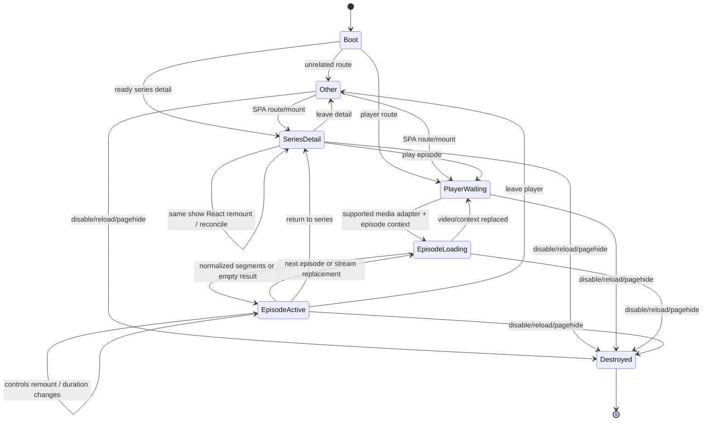

# ShowSkip Architecture

Status: Phase 3 playback-action architecture complete behind a production-disabled gate; automated and public-web DOM validation complete; consolidated packaged Enhanced Phase 2 + 3 validation pending
Research dates: provider/seek baseline 2026-08-20; next-action sources 2026-08-29; public trailer DOM recheck 2026-09-05
Target: Stremio Enhanced for Windows
Artifact: one self-contained `ShowSkip.plugin.js`

## 1. Scope and non-goals

ShowSkip is a Stremio Enhanced UI/player plugin, not a Stremio addon. Phase 1 provides per-series playback-rule configuration for recap, intro, credits, preview, and next-episode behavior. Phase 2 resolves active episode/media context, fetches and validates TheIntroDB timestamps, and renders behavior-independent timeline regions whenever a supported HTML video and native seek bar are available. Phase 3 implements conservative skip/action machinery, but the installed production artifact passes a literal false release gate to every playback-mutating boundary, so it still performs no seek, skip-button action, or episode transition.

Phase 0 contained no production plugin, UI, player mutation, or server component. Phase 1 added the standalone foundation and per-show configuration UI recorded in section 14. Phase 2 added the client-side episode/provider/timeline implementation recorded in section 15. Phase 3 adds the gated action architecture recorded in section 16. The project does not modify Stremio Enhanced, Stremio Web, normal Stremio, Stremio Service, or `server.js`.

## 2. Research baseline

All repository conclusions below are pinned to commits rather than floating branches.

| Reference | Verified revision | Relevant version |
| --- | --- | --- |
| [REVENGE977/stremio-enhanced](https://github.com/REVENGE977/stremio-enhanced) | [`0bb39a4263c26970247128c36d9ef8bd8a3c84ad`](https://github.com/REVENGE977/stremio-enhanced/commit/0bb39a4263c26970247128c36d9ef8bd8a3c84ad), `main`, 2026-06-26 | 1.2.0 |
| [TheIntroDB/stremio-enhanced-plugin](https://github.com/TheIntroDB/stremio-enhanced-plugin) | [`d9e5e4d96ba430f85e456272d3099d03d8ac63cf`](https://github.com/TheIntroDB/stremio-enhanced-plugin/commit/d9e5e4d96ba430f85e456272d3099d03d8ac63cf), `main`, 2026-08-08 | 1.1.4 |
| [Stremio/stremio-web](https://github.com/Stremio/stremio-web) | [`89927a60d104b94ae07486a317edefeb93e4f79a`](https://github.com/Stremio/stremio-web/commit/89927a60d104b94ae07486a317edefeb93e4f79a), `development`, 2026-08-19 | 5.0.0-beta.39 |
| [Stremio/stremio-web current next-action recheck](https://github.com/Stremio/stremio-web) | [`00a63c199a841e70ffaa697d4fba65974ba28ead`](https://github.com/Stremio/stremio-web/commit/00a63c199a841e70ffaa697d4fba65974ba28ead), `main`, 2026-08-26 | current source pinned 2026-08-29 |
| [Stremio/stremio-core current next-action recheck](https://github.com/Stremio/stremio-core) | [`e8862f2caf013c3314a1f4097c4ab51e6b7ba997`](https://github.com/Stremio/stremio-core/commit/e8862f2caf013c3314a1f4097c4ab51e6b7ba997), `development` | current source pinned 2026-08-29 |
| [Stremio/stremio-video](https://github.com/Stremio/stremio-video) | [`607afd84e83ae4260b5ef24a3b328eb3f898cb3c`](https://github.com/Stremio/stremio-video/commit/607afd84e83ae4260b5ef24a3b328eb3f898cb3c), the npm `gitHead` used by current Stremio Web | 0.0.93 |
| [TheIntroDB API reference](https://theintrodb.org/docs) | Live documentation and [OpenAPI 3.0 specification](https://theintrodb.org/openapi.yaml), read 2026-08-20 | API v3.0.0 |

The Phase 2 seek-bar recheck also compared the official `v5.0.0-beta.39` Stremio Web tag at [`94a7be7c11e72bca1f8b7aa44cbdb5755a8cc7e1`](https://github.com/Stremio/stremio-web/commit/94a7be7c11e72bca1f8b7aa44cbdb5755a8cc7e1) with development commit [`115f09fab22252cd277cd70856124a6b4714b65f`](https://github.com/Stremio/stremio-web/commit/115f09fab22252cd277cd70856124a6b4714b65f). The release renders the slider directly beneath the seek bar; the later development source adds a wrapper. Phase 2 accepts either structure only after the same seek-specific native layers validate. The older pinned row remains the reference for source links elsewhere in this document.

The deployed `https://web.stremio.com/` UI was also inspected on 2026-08-20. Settings reported App Version `6.0.1-beta.09`, Build Version `6ed4463d94baf972dda2630c914ce91c747f9f7c`, and Server Version `4.20.17`. The build string appears in the main asset path, but its linked GitHub tree currently returns 404; it is not treated as a verified Git commit. Pinned source findings and live deployment observations are therefore kept distinct.

Evidence labels used in this document:

- **Source-verified** means current pinned source or first-party API documentation establishes the behavior.
- **Live-verified** means the deployed public Stremio Web DOM was inspected on the research date.
- **Phase validation** means the behavior could not be proven without running inside Stremio Enhanced with a real series stream.

## 3. Stremio Enhanced plugin architecture

### 3.1 File discovery and installation

On Windows, Enhanced resolves the plugin directory to:

```text
%APPDATA%\stremio-enhanced\plugins
```

The fallback when `APPDATA` is absent is `<home>\AppData\Roaming\stremio-enhanced\plugins`. This is defined in [`Properties.ts`](https://github.com/REVENGE977/stremio-enhanced/blob/0bb39a4263c26970247128c36d9ef8bd8a3c84ad/src/core/Properties.ts#L7-L16), and the application creates the directories at startup in [`main.ts`](https://github.com/REVENGE977/stremio-enhanced/blob/0bb39a4263c26970247128c36d9ef8bd8a3c84ad/src/main.ts#L141-L163).

Discovery is non-recursive. Startup loading and the Settings list only consider direct child filenames ending exactly and case-sensitively in `.plugin.js`; see [`initialization.ts`](https://github.com/REVENGE977/stremio-enhanced/blob/0bb39a4263c26970247128c36d9ef8bd8a3c84ad/src/preload/setup/initialization.ts#L54-L67) and [`settingsInjector.ts`](https://github.com/REVENGE977/stremio-enhanced/blob/0bb39a4263c26970247128c36d9ef8bd8a3c84ad/src/preload/ui/settings/settingsInjector.ts#L48-L97).

The supported local workflow is:

1. Copy `ShowSkip.plugin.js` into the plugin directory.
2. Restart Enhanced or press `Ctrl+R`.
3. Open Settings → Enhanced → Plugins and enable ShowSkip.

Enhanced stores enabled filenames in Stremio Web `localStorage` under `enabledPlugins` and reloads enabled files on the next renderer load.

### 3.2 Metadata header

Enhanced parses the first `/** ... */` block in the file. Required keys are `name`, `description`, `author`, and `version`; optional allowlisted keys are `updateUrl`, `source`, `license`, `homepage`, and `requirements`. The parser and lists are authoritative in [`ExtractMetaData.ts`](https://github.com/REVENGE977/stremio-enhanced/blob/0bb39a4263c26970247128c36d9ef8bd8a3c84ad/src/utils/ExtractMetaData.ts#L15-L50) and [`MetaData.ts`](https://github.com/REVENGE977/stremio-enhanced/blob/0bb39a4263c26970247128c36d9ef8bd8a3c84ad/src/interfaces/MetaData.ts#L5-L45).

The current artifact begins with this block, with no earlier JSDoc comment:

```javascript
/**
 * @name ShowSkip
 * @description Per-show segment skipping and next-episode rules for Stremio Enhanced.
 * @updateUrl none
 * @version 0.2.0
 * @author ShowSkip contributors
 */
```

`@updateUrl none` is a security policy, not a temporary placeholder. Enhanced otherwise fetches the URL as plugin source and can overwrite the local file; the `none` guard is in [`ModManager.ts`](https://github.com/REVENGE977/stremio-enhanced/blob/0bb39a4263c26970247128c36d9ef8bd8a3c84ad/src/core/ModManager.ts#L94-L99). ShowSkip will keep updates disabled unless the user explicitly approves a host-managed remote-code exception and a controlled release URL. `@source` and `@license` should be added after the public repository URL and project license are selected. Metadata values are single-line, keys are case-sensitive, unknown keys are ignored, and the first duplicate wins.

There is no metadata permission field, plugin ID, API version, or minimum Enhanced version. `requirements` is used for theme dependencies and is not a permissions mechanism.

### 3.3 Loading and execution

Enhanced reads the full plugin, wraps it in a normal non-async IIFE, creates a lexically scoped `StremioEnhancedAPI`, and appends an inline script whose element ID is the full filename. The source is in [`modController.ts`](https://github.com/REVENGE977/stremio-enhanced/blob/0bb39a4263c26970247128c36d9ef8bd8a3c84ad/src/preload/ui/mod/modController.ts#L15-L61).

Consequences:

- `ShowSkip.plugin.js` receives the settings namespace `ShowSkip`.
- The plugin can manipulate the page DOM and use browser APIs such as `fetch`.
- A bare top-level `await` is invalid despite an example in the current [plugin wiki](https://github.com/REVENGE977/stremio-enhanced/wiki/Plugins); asynchronous startup needs an inner async function or promise chain.
- The loader catches synchronous execution errors only. Later promise/event errors must be handled by ShowSkip.
- No manifest-declared permission model exists. ShowSkip will voluntarily restrict itself to DOM access, the scoped settings/logger API, and direct TheIntroDB segment requests.

### 3.4 Scoped API and storage

The plugin-scoped surface is defined in [`modController.ts`](https://github.com/REVENGE977/stremio-enhanced/blob/0bb39a4263c26970247128c36d9ef8bd8a3c84ad/src/preload/ui/mod/modController.ts#L28-L41):

- `StremioEnhancedAPI.logger.info|warn|error(message)`
- `getSetting(key)`
- `saveSetting(key, value)`
- `registerSettings(schema)`
- `onSettingsSaved(callback)`
- `showAlert(...)`
- `showPrompt(...)`

This lexical facade is a convenience namespace, not a security sandbox. Enhanced also exposes a broader `window.StremioEnhancedAPI`, has no per-plugin permission declarations, and creates its BrowserWindow with `webSecurity: false`, `nodeIntegration: true`, and `contextIsolation: true` in [`main.ts`](https://github.com/REVENGE977/stremio-enhanced/blob/0bb39a4263c26970247128c36d9ef8bd8a3c84ad/src/main.ts#L60-L75). Whether Node globals reach the page-world injected plugin was not live-verified and is irrelevant by design: ShowSkip will use only the lexical facade above, DOM/browser primitives, and direct segment API fetches.

There is no generic plugin storage service. `saveSetting` writes JSON values into:

```text
%APPDATA%\stremio-enhanced\plugins\ShowSkip.plugin.json
```

The implementation reads and rewrites the JSON object for each save. A first `getSetting` call rejects after creating an absent config file; later missing keys resolve to `null`. See [`SettingsApiController.ts`](https://github.com/REVENGE977/stremio-enhanced/blob/0bb39a4263c26970247128c36d9ef8bd8a3c84ad/src/controllers/api/SettingsApiController.ts#L11-L61).

ShowSkip uses `getSetting`/`saveSetting` directly and does not register global Settings controls. This keeps per-show behavior on the series page as required. On the first rejection, the storage adapter retries once because Enhanced may just have created the absent config file; a subsequent `null` is a clean empty store. A repeated rejection is treated as unreadable/corrupt storage: the UI uses in-memory defaults, persistence is disabled for that session, and one warning is logged rather than attempting raw file repair or destructive overwrite.

`registerSettings` and `onSettingsSaved` are deliberately avoided. The former accepts only input/toggle/select schemas and its process-lifetime registration can conflict after a renderer reload; the latter has no unsubscribe and delivers the whole config after replacing prior listeners for that plugin channel. Those behaviors are documented in [`settings.ts`](https://github.com/REVENGE977/stremio-enhanced/blob/0bb39a4263c26970247128c36d9ef8bd8a3c84ad/src/preload/api/settings.ts) and [`SettingsApiController.ts`](https://github.com/REVENGE977/stremio-enhanced/blob/0bb39a4263c26970247128c36d9ef8bd8a3c84ad/src/controllers/api/SettingsApiController.ts).

Profile mutations run through one serialized read/validate/update/save queue. Main-process file writes are synchronous, but renderer calls are asynchronous; serialization prevents an older plugin-side `state_v1` snapshot from overwriting a newer panel change.

### 3.5 Disable and cleanup limitations

Enhanced has no plugin unload callback. Disabling removes only the injected script node and the enabled filename; already-created listeners, observers, timers, styles, and DOM survive until reload. See the loader removal in [`modController.ts`](https://github.com/REVENGE977/stremio-enhanced/blob/0bb39a4263c26970247128c36d9ef8bd8a3c84ad/src/preload/ui/mod/modController.ts#L64-L71); the Settings UI separately warns that a reload is required at [lines 255–276](https://github.com/REVENGE977/stremio-enhanced/blob/0bb39a4263c26970247128c36d9ef8bd8a3c84ad/src/preload/ui/mod/modController.ts#L255-L276).

Host operations differ:

- **Disable:** removes the injected script node, so ShowSkip's node-removal observer can opportunistically destroy the running instance; reload remains the documented fallback.
- **Uninstall:** removes the `.plugin.js` file and enabled entry but not the already-injected script node; the current instance can remain active until pagehide/reload. The generated `ShowSkip.plugin.json` is retained. See [`ModManager.ts`](https://github.com/REVENGE977/stremio-enhanced/blob/0bb39a4263c26970247128c36d9ef8bd8a3c84ad/src/core/ModManager.ts#L70-L80).
- **Update:** overwrites the plugin file but does not re-execute the running instance; the new code starts after reload. See [`modController.ts`](https://github.com/REVENGE977/stremio-enhanced/blob/0bb39a4263c26970247128c36d9ef8bd8a3c84ad/src/preload/ui/mod/modController.ts#L279-L284).

ShowSkip implements reversible cleanup:

- keep one global singleton (`window.__showSkipPlugin`);
- destroy an older singleton before starting a new one;
- locate the loader script with `document.getElementById('ShowSkip.plugin.js')`, observe its parent, and call `destroy()` opportunistically if that exact node is removed;
- destroy on `pagehide`/`beforeunload`;
- store references for every listener, observer, timeout, animation frame, and injected node;
- abort active provider requests on context changes.

Script-removal teardown must be live-tested in Enhanced. Uninstall/update limitations cannot be repaired by plugin code; reload remains the host-supported boundary.

## 4. TheIntroDB provider contract

### 4.1 Current read API

The primary endpoint is a direct client-side request:

```text
GET https://api.theintrodb.org/v3/media
```

The current first-party [API reference](https://theintrodb.org/docs) and [OpenAPI specification](https://theintrodb.org/openapi.yaml) establish:

- identify media with one of `tmdb_id`, `tvdb_id`, or `imdb_id`;
- TMDB is preferred by the API, with priority `tmdb_id` → `tvdb_id` → `imdb_id` if more than one is supplied;
- TV lookups also require integer `season` and `episode` values starting at 1;
- `duration_ms` is optional and asks the service to select the closest known release version;
- anonymous reads need no authentication and include accepted submissions;
- a successful body contains `tmdb_id`, `type`, optional `season`/`episode`, and zero or more arrays named `intro`, `recap`, `credits`, and `preview`;
- v3 has no `postCredits` or post-credit-scene field. `preview` remains a preview and is never relabeled as post-credit content;
- each array item has nullable integer `start_ms` and `end_ms`;
- the read schema explicitly calls out a null intro start; submission business rules also allow recap null/zero as beginning-of-media, so ShowSkip defensively accepts that cross-section-compatible form; credits/preview may end at `null` (end of media);
- zero has type-specific sentinel meaning: an intro/recap may legitimately start at zero, but a credits/preview start of zero means no segment; an end of zero means no segment for every type;
- absent segment types are omitted;
- the current OpenAPI schema does not promise confidence or submission counts, although the [current official client tolerates similarly named fields](https://github.com/TheIntroDB/theintrodb-npm/blob/842937ffd825bb79284ad8a1ee78a79068abc7fc/src/funcs.ts#L413-L473). ShowSkip does not trust undocumented fields: `confidence` remains `null`, and no submission-count field is emitted;
- 400 is an invalid request, 404 is no accepted media data, 429 is a rate/usage limit, and 500 is a server failure.

The OpenAPI document states an anonymous `GET /media` usage limit of 500 requests per IP per day and an endpoint rate limit of 30 requests per 10 seconds. ShowSkip therefore needs request deduplication, an in-memory session cache, aborts, and restrained retry behavior. A short endpoint-rate limit and an exhausted daily usage allowance are different states even though both use HTTP 429.

The [live endpoint was sampled](https://api.theintrodb.org/v3/media?imdb_id=tt0903747&season=1&episode=1) on 2026-08-20. It returned `tmdb_id: 1396`, `type: tv`, season/episode 1/1, an intro range, and credits with `end_ms: null`. The production plugin validates every response rather than assuming the sample. The current OpenAPI does not specify 204, but the official plugin treats 204 like no data; ShowSkip tolerates it as an empty legacy response while treating 404 as the current negative result.

The implemented fetch policy is deliberately bounded. It requires a finite positive observed duration, waits for a 750 ms quiet window, rounds to a positive safe integer, and sends that exact `duration_ms` with `Accept: application/json`. Requests are direct anonymous GETs with omitted credentials, `no-store`, redirect rejection, and no referrer or API key. In-flight callers deduplicate by the canonical exact-duration cache key while retaining independent cancellation; the underlying fetch aborts when its context ends or every subscriber cancels. The session-only LRU holds at most 24 validated results. At most two distinct duration keys may issue per media-source/context token, and source/context replacement resets stabilization.

Each attempt has an 8-second lifetime covering both response headers and body consumption, and a response is rejected above 256 KiB by declared length, streamed byte count, decoded-text byte count, or validated serialized size. A network error, timeout, or 5xx receives at most one retry after a short abortable delay. A 429 receives at most one retry only when `X-RateLimit-Reset` is a non-negative integer delay within the 2-second cap. Exact `code: usage_limit_exceeded` or `X-UsageLimit-Remaining: 0` evidence marks the session daily-exhausted; other 429s stop only that lookup. Cache lookup intentionally precedes the daily-limit gate, so already-validated results remain usable. Only validated 200 results and explicit 404/legacy-204 negatives are cached—never aborts, malformed/oversized bodies, other 4xx, 429, network failures, or 5xx. Live route, video identity, source, duration, and monotonic episode/media tokens are all rechecked before rendering a completion.

### 4.2 Findings from the official Enhanced plugin

The current TheIntroDB plugin is distributed under [GPL-3.0](https://github.com/TheIntroDB/stremio-enhanced-plugin/blob/d9e5e4d96ba430f85e456272d3099d03d8ac63cf/LICENSE#L1) and is a behavioral reference, not a code template. Its current implementation:

- uses API v3 and four types at [`tidb.plugin.js` lines 14–58](https://github.com/TheIntroDB/stremio-enhanced-plugin/blob/d9e5e4d96ba430f85e456272d3099d03d8ac63cf/tidb.plugin.js#L14-L58);
- reconciles DOM/player changes with a body `MutationObserver` plus a two-second interval at [lines 250–261](https://github.com/TheIntroDB/stremio-enhanced-plugin/blob/d9e5e4d96ba430f85e456272d3099d03d8ac63cf/tidb.plugin.js#L250-L261);
- resolves a URL context and then tries `window.services.core.transport.getState('player')` at [lines 655–668](https://github.com/TheIntroDB/stremio-enhanced-plugin/blob/d9e5e4d96ba430f85e456272d3099d03d8ac63cf/tidb.plugin.js#L655-L668) and [758–781](https://github.com/TheIntroDB/stremio-enhanced-plugin/blob/d9e5e4d96ba430f85e456272d3099d03d8ac63cf/tidb.plugin.js#L758-L781);
- sends IMDb or presumed TMDB identity, season/episode, and HTML video duration to `/media` at [lines 819–838](https://github.com/TheIntroDB/stremio-enhanced-plugin/blob/d9e5e4d96ba430f85e456272d3099d03d8ac63cf/tidb.plugin.js#L819-L838);
- normalizes null starts to zero seconds and keeps null ends at [lines 857–866](https://github.com/TheIntroDB/stremio-enhanced-plugin/blob/d9e5e4d96ba430f85e456272d3099d03d8ac63cf/tidb.plugin.js#L857-L866);
- scopes its marker implementation only to a generic slider selector at [lines 902–918](https://github.com/TheIntroDB/stremio-enhanced-plugin/blob/d9e5e4d96ba430f85e456272d3099d03d8ac63cf/tidb.plugin.js#L902-L918);
- provides explicit media cleanup and singleton replacement at [lines 1109–1157](https://github.com/TheIntroDB/stremio-enhanced-plugin/blob/d9e5e4d96ba430f85e456272d3099d03d8ac63cf/tidb.plugin.js#L1109-L1157).

ShowSkip independently implements the documented API contract. It uses the useful concepts—state-first episode context, duration-aware lookup, normalized segment arrays, reconciliation, and explicit teardown—but does not copy GPL implementation bodies. It excludes the reference plugin's analytics, user-stats request, global settings UI, and remote SVG icon.

The eventual ShowSkip `LICENSE` will cover ShowSkip code only. It will not purport to license or grant redistribution rights to TheIntroDB timestamp data; a separate notice will preserve that code/data distinction. Clean implementation means no copied or cosmetically renamed GPL functions or assets.

### 4.3 Terms, attribution, and caching

[TheIntroDB Terms of Service](https://theintrodb.org/docs/terms), last updated 2026-06-16 when reviewed, limits timestamp data to direct client-side, non-commercial end-user applications. It permits temporary client-side caching for performance but prohibits building, persisting, redistributing, or reconstructing the database. Commercial use requires a separate agreement.

The Terms also state that users are expected to have legal access to the underlying media. ShowSkip neither locates nor grants media access; it operates only on playback already opened by the user.

Architecture consequences:

- every request originates from the user's Enhanced renderer directly to `api.theintrodb.org`;
- validated segment results are held only in memory for the current plugin/renderer session and are not written to `ShowSkip.plugin.json`;
- ShowSkip does not scrape, bulk fetch, proxy, mirror, or redistribute timestamps;
- only after at least one TheIntroDB marker actually renders, an in-memory per-show flag causes that show's open panel to include unobtrusive “Timestamp data by TheIntroDB” attribution using the exact destination currently specified by the Terms, `https://theintrodb.com`. The flag and provider data are not persisted, and no-data episodes do not create attribution. Attribution is requested but not required by default; written notice can make it required on 14 days' notice. A panel that disappears when closed is not assumed to satisfy a future mandatory-attribution notice, so placement and the `.com`/official `.org` discrepancy must both be rechecked before release;
- the release remains non-commercial unless separate terms are obtained.

## 5. Stremio Web context and DOM findings

### 5.1 Routes and identifiers

Current route definitions are source-verified in [`routerPaths.tsx`](https://github.com/Stremio/stremio-web/blob/89927a60d104b94ae07486a317edefeb93e4f79a/src/router/routerPaths.tsx#L33-L54) and [`routesRegexp.js`](https://github.com/Stremio/stremio-web/blob/89927a60d104b94ae07486a317edefeb93e4f79a/src/common/routesRegexp.js#L31-L47):

```text
#/detail/:type?/:id?/:videoId?
#/metadetails/:type?/:id?/:videoId?
#/player/:stream/:streamTransportUrl?/:metaTransportUrl?/:type?/:id?/:videoId?
```

The leading `#` is the browser form because the app uses `HashRouter` in [`src/index.js`](https://github.com/Stremio/stremio-web/blob/89927a60d104b94ae07486a317edefeb93e4f79a/src/index.js#L14-L56); route parsing must decode individual segments defensively and reject malformed encodings rather than decoding the whole hash as one value.

The series detail route's `id` is the show/meta ID; optional `videoId` identifies the selected episode. [`MetaDetails.js`](https://github.com/Stremio/stremio-web/blob/89927a60d104b94ae07486a317edefeb93e4f79a/src/routes/MetaDetails/MetaDetails.js#L20-L24) receives all three values and passes the ready meta ID into `MetaPreview` at [lines 174–195](https://github.com/Stremio/stremio-web/blob/89927a60d104b94ae07486a317edefeb93e4f79a/src/routes/MetaDetails/MetaDetails.js#L174-L195), but [`MetaPreview` does not consume that prop](https://github.com/Stremio/stremio-web/blob/89927a60d104b94ae07486a317edefeb93e4f79a/src/components/MetaPreview/MetaPreview.js#L28-L29) or render it into a stable DOM attribute. ShowSkip therefore parses the route rather than inferring identity from visible titles.

Canonical show key policy:

1. If the decoded series `id` matches `^tt[0-9]{7,}$`, store `imdb:<lowercase id>`.
2. Otherwise store `stremio:series:<percent-encoded exact id>`.
3. Never use the episode `videoId` as the profile key.

The implemented player parser accepts only the exact seven-component route shape `player/stream/streamTransport/metaTransport/type/id/videoId`; the two transport slots may be empty, but type must decode to `series`. A short `#/player/:stream` route is recognized as a player but deliberately marked ineligible, which covers the currently observed trailer route. Route episode fallback is accepted only when decoded `videoId` ends in an anchored `:<positive season>:<positive episode>` suffix **and** the exact remaining prefix equals decoded route `id`; otherwise identity fails closed. This handles route IDs that themselves contain colons without treating arbitrary trailing numbers as episode proof.

`CoreStateReader` captures and binds up to six validated readers from current or previously observed `core.getState`, `services.core.getState`, and `services.core.transport.getState` owners. Currently present readers take priority over retained readers, and each read is bounded. `EpisodeIdentityProvider` accepts only a `Ready` series player state whose meta ID and season/episode match the route; any present selected request or library video ID must also agree. Loading/not-requested state is unavailable, while a contradictory ready/terminal shape invalidates route-only work and clears media, requests, and markers. A later core match promotes route-only identity to `route+core`. Every async boundary rechecks the active route signature and monotonic episode/media token.

Canonical profile identity and provider eligibility remain separate. The current runtime identity path exposes an IMDb provider ID only when the series ID matches `^tt[0-9]{7,8}$`; it never invents TMDB/TVDB identity or reinterprets an arbitrary Stremio ID. Longer IMDb-style and non-IMDb IDs remain valid namespaced profile keys but receive no TheIntroDB request in Phase 2.

### 5.2 Series action row

Source order in [`MetaPreview.js`](https://github.com/Stremio/stremio-web/blob/89927a60d104b94ae07486a317edefeb93e4f79a/src/components/MetaPreview/MetaPreview.js#L210-L276) is Trailer, the library/watched action group, optional Show, optional ratings, and optional Share. Native action buttons are circular and use theme variables in [`ActionButton/styles.less`](https://github.com/Stremio/stremio-web/blob/89927a60d104b94ae07486a317edefeb93e4f79a/src/components/MetaPreview/ActionButton/styles.less#L5-L41). The containing row's layout is in [`MetaPreview/styles.less`](https://github.com/Stremio/stremio-web/blob/89927a60d104b94ae07486a317edefeb93e4f79a/src/components/MetaPreview/styles.less#L156-L224).

Live deployment validation on `#/detail/series/tt9288030` found this hierarchy:

```text
metadetails container
└─ metadetails content
   └─ meta preview
      └─ action buttons row
         ├─ Trailer
         ├─ library/watched ActionsGroup
         └─ Share
```

The deployed hashed class names are evidence only and must not be hard-coded. No stable ID, test attribute, role, or accessible label exists on the row itself.

Chosen insertion strategy:

- activate only when the parsed route is `detail|metadetails`, type is `series`, and the meta preview is ready;
- locate the active meta detail root and meta preview structurally, using the centralized `action-buttons-container-` CSS-module token prefix only at this final DOM boundary;
- locate the direct action-row child of that active meta preview;
- append one ShowSkip launcher as the final action-row child rather than depending on Trailer text, localization, native child count, or a specific sibling;
- tag all owned nodes with stable `data-showskip-*` attributes and reconcile idempotently after React remounts;
- visually match the current circular control using Stremio CSS variables and an inline SVG, not by cloning a native element or fetching an icon.

Appending is the least fragile current placement and keeps the launcher next to Trailer/library/watched/share. Exact prefix selectors and responsive placement require Phase 1 validation inside Enhanced.

### 5.3 Video element and seek bar

The current player renders a container into which `@stremio/stremio-video` mounts the selected implementation; the outer component is in [`Video.js`](https://github.com/Stremio/stremio-web/blob/89927a60d104b94ae07486a317edefeb93e4f79a/src/routes/Player/Video/Video.js#L7-L13). The exact selector precedence in pinned [`selectVideoImplementation.js`](https://github.com/Stremio/stremio-video/blob/607afd84e83ae4260b5ef24a3b328eb3f898cb3c/src/StremioVideo/selectVideoImplementation.js#L14-L68) matters:

1. A missing stream or `externalUrl` selects no in-page implementation.
2. A connected Chromecast wins next.
3. A `ytId` selects a YouTube implementation: desktop uses `YouTubeVideo`, while Tizen/webOS use `YouTubeIFrameVideo`.
4. Only then does `shellTransport` select MPV-backed `ShellVideo`, which creates no HTML media element.
5. Otherwise a `streamingServerURL`, then a supported direct `stream.url`, selects the applicable platform implementation; on Enhanced Windows this is wrapped `HTMLVideo`.

Stremio Enhanced is a different Electron wrapper from the official Windows shell. Its pinned source loads `https://web.stremio.com/` and, on Windows, lets the user supply a local streaming backend through Stremio Service or managed `server.js`; see [`main.ts` lines 91–125](https://github.com/REVENGE977/stremio-enhanced/blob/0bb39a4263c26970247128c36d9ef8bd8a3c84ad/src/main.ts#L91-L125) and [lines 167–187](https://github.com/REVENGE977/stremio-enhanced/blob/0bb39a4263c26970247128c36d9ef8bd8a3c84ad/src/main.ts#L167-L187). It does not supply the official WebView2 shell transport, which current Stremio Web recognizes through [`useShell.ts`](https://github.com/Stremio/stremio-web/blob/89927a60d104b94ae07486a317edefeb93e4f79a/src/common/Platform/shell/useShell.ts#L4-L6). ShowSkip touches neither streaming backend.

It is therefore a source-supported inference—not yet a target-runtime observation—that ordinary built-in playback in Enhanced 1.2.0 exposes an HTML `<video>`. Live public-web validation with a public-domain stream showed `<video playsinline>` under the current player container, and the official TheIntroDB Enhanced plugin relies on the same path. Stremio itself scopes HTML-media lookup through its video host at [`Player.js` lines 92–98](https://github.com/Stremio/stremio-web/blob/89927a60d104b94ae07486a317edefeb93e4f79a/src/routes/Player/Player.js#L92-L98). Packaged Enhanced confirmation with a real built-in series stream remains required.

The assumption has explicit limits: YouTube, Chromecast, external-player, and any future shell-backed path may not expose `<video>`. A live YouTube trailer rendered an iframe and no page-level video. `HtmlMediaAdapter` is created only when the last active route root contains exactly one visible player container, exactly one visible video container, and exactly one connected visible `<video>`. Zero or multiple candidates fail closed. Its snapshot includes current time, rounded duration, ready state, source, paused/seeking/ended flags, and playback rate. Phase 2 observation remains active normally. Phase 3 exposes `seekToMs`, but `capabilities.canSeek` is false in production because the literal gate is false; controlled tests may construct an enabled adapter. A non-empty source and finite positive duration are additionally required before lookup or markers.

Enhanced's optional MPV/VLC setting is a separate external-process flow, not Stremio Web's `ShellVideo`. When enabled, Enhanced backs out of the built-in player before launching the external executable in [`externalPlayerInterceptor.ts`](https://github.com/REVENGE977/stremio-enhanced/blob/0bb39a4263c26970247128c36d9ef8bd8a3c84ad/src/preload/ui/externalPlayerInterceptor.ts#L15-L50). The scoped plugin API supplies no external-player clock, duration, subscription, or seek surface. ShowSkip therefore provides no on-page markers or skipping in external-player mode. It will not attempt raw MPV IPC, React internals, or synthetic seek-bar dragging.

For the supported path, `HTMLVideo` creates and attaches the element in [`HTMLVideo.js` lines 18–100](https://github.com/Stremio/stremio-video/blob/607afd84e83ae4260b5ef24a3b328eb3f898cb3c/src/HTMLVideo/HTMLVideo.js#L18-L100), and Stremio's own abstraction seeks by assigning `currentTime` after converting milliseconds to seconds at [lines 415–418](https://github.com/Stremio/stremio-video/blob/607afd84e83ae4260b5ef24a3b328eb3f898cb3c/src/HTMLVideo/HTMLVideo.js#L415-L418). Phase 3 uses the same underlying HTML-media primitive only inside its adapter after stricter context/seekability checks. Packaged validation must still prove Stremio UI, resume offset, history, and library bookkeeping follow the direct assignment before the production gate may be enabled.

The seek bar renders a `Slider` between time labels in [`SeekBar.js`](https://github.com/Stremio/stremio-web/blob/89927a60d104b94ae07486a317edefeb93e4f79a/src/routes/Player/ControlBar/SeekBar/SeekBar.js#L44-L69). The slider owns four absolute layers: base track, buffered track, played/masked track, and thumb; see [`Slider.js`](https://github.com/Stremio/stremio-web/blob/89927a60d104b94ae07486a317edefeb93e4f79a/src/components/Slider/Slider.js#L134-L153) and [`Slider/styles.less`](https://github.com/Stremio/stremio-web/blob/89927a60d104b94ae07486a317edefeb93e4f79a/src/components/Slider/styles.less#L19-L92). CSS modules compile with generated suffixes, so those suffixes are never selectors; see [`webpack.config.js`](https://github.com/Stremio/stremio-web/blob/89927a60d104b94ae07486a317edefeb93e4f79a/webpack.config.js#L91-L98).

Current public-web validation reconfirmed that seek and volume controls share the same generated slider class. It also observed the active `player-container-*` → `control-bar-container-*` → `seek-bar-container-*` hierarchy and the current four native slider layers (track, before, after, thumb). Therefore a global “first slider” selector is unsafe, and generated suffixes remain evidence rather than production selectors.

Chosen marker anchor:

```text
current player container
└─ current control bar
   └─ seek-bar container
      └─ slider container   ← ShowSkip overlay host
```

`resolveActiveSeekTarget` implements that full hierarchy. It requires one seek bar and one non-volume slider outside the control-bar button group, then validates one each of the native track, track-before, track-after, and thumb structures. It accepts both the current release's direct seek-slider form and the source/development form with an extra wrapper because the final structural proof is unchanged. Ambiguity or a missing native layer fails closed. The renderer inserts exactly one owned layer directly before the validated native thumb layer, removes stale owned layers document-wide, and never modifies a native node.

The Phase 0 proposal to make the overlay `aria-hidden` was corrected during implementation: hiding it would also hide useful keyboard semantics. The layer is an accessible group, and every marker is a focusable `role="img"` with a type/time-range `aria-label`. Marker and layer pointer events remain disabled so native dragging/clicking passes through; one passive listener on the slider supplies a temporary hover tooltip, while focus has priority and supplies the same information. The owned layer has `z-index: 0` and native track height, is inserted below the thumb, and becomes `visibility: hidden` with Stremio's `overlayHidden-*` control state so invisible markers are not keyboard stops. Percent geometry uses only already-validated in-duration ranges; boundary clamping is rendering-only. The document reconciler and cached bundle reattach markers after control remount without refetching.

### 5.4 Player state and next episode

The official player model includes `metaItem`, `seriesInfo`, and `nextVideo`; see [`Player.d.ts`](https://github.com/Stremio/stremio-web/blob/89927a60d104b94ae07486a317edefeb93e4f79a/src/core/types/models/Player.d.ts#L53-L65). It does not expose the live media clock, duration, or pause state; core state is for identity/bookkeeping, not a replacement for `PlaybackAdapter`.

The current TheIntroDB plugin tries `window.services.core.transport.getState('player')`. Enhanced's own internal playback helper instead probes direct `core.getState('player')` after finding `window.core || window.services?.core` in [`PlaybackState.ts`](https://github.com/REVENGE977/stremio-enhanced/blob/0bb39a4263c26970247128c36d9ef8bd8a3c84ad/src/utils/PlaybackState.ts#L32-L57) and [`Helpers.ts`](https://github.com/REVENGE977/stremio-enhanced/blob/0bb39a4263c26970247128c36d9ef8bd8a3c84ad/src/utils/Helpers.ts#L165-L238). That helper is internal, is not in the scoped plugin API, and uses dynamic evaluation, so ShowSkip does not copy or depend on it. It documents that the live core global may disappear during playback; Phase 2 therefore captures bound readers from the three known shapes without replacing host globals or using `eval`. Reads remain bounded, own-property shape-checked, and route-cross-checked. Ordinary deployed Stremio Web did not expose `window.services` during live browser inspection, so exact Enhanced reader availability remains a packaged-runtime question; the strict route fallback keeps Phase 2 usable while later reconciles continue trying to promote or invalidate it.

Core seek dispatch alone is not media control: Stremio Web performs both private media control and core bookkeeping. Phase 3 therefore uses no guessed core seek action. Its only position write is a direct HTML-media assignment inside `HtmlMediaAdapter`, after a stronger `route+core` action proof and current seekable-range validation. Packaged Enhanced still must prove that the native UI, resume position, seek history, and library bookkeeping remain coherent before activation.

The 2026-08-29 current-source recheck establishes why next episode remains unavailable in production:

1. `player.nextVideo` is the authoritative availability value in current [`Player.d.ts`](https://github.com/Stremio/stremio-web/blob/00a63c199a841e70ffaa697d4fba65974ba28ead/src/core/types/models/Player.d.ts#L61-L72).
2. The native flow dispatches `Player → NextVideo` in [`usePlayer.js`](https://github.com/Stremio/stremio-web/blob/00a63c199a841e70ffaa697d4fba65974ba28ead/src/routes/Player/usePlayer.js#L150-L157) and separately performs React-router navigation from validated deep links in the [compound player handler](https://github.com/Stremio/stremio-web/blob/00a63c199a841e70ffaa697d4fba65974ba28ead/src/routes/Player/Player.js#L353-L361). Core itself performs bookkeeping and explicitly leaves loading to the separate navigation step in [`player.rs`](https://github.com/Stremio/stremio-core/blob/e8862f2caf013c3314a1f4097c4ab51e6b7ba997/src/models/player.rs#L695-L735). Raw dispatch is therefore only half a transition.
3. Enhanced's [scoped plugin API](https://github.com/REVENGE977/stremio-enhanced/blob/0bb39a4263c26970247128c36d9ef8bd8a3c84ad/src/preload/ui/mod/modController.ts#L26-L54) exposes settings/logging/alerts/prompts, not a compound next action or router.
4. The native control is core-aware but private: current [`ControlBar.js`](https://github.com/Stremio/stremio-web/blob/00a63c199a841e70ffaa697d4fba65974ba28ead/src/routes/Player/ControlBar/ControlBar.js#L141-L153) renders a generic [`<div>` button](https://github.com/Stremio/stremio-web/blob/00a63c199a841e70ffaa697d4fba65974ba28ead/src/components/Button/Button.tsx#L58-L69) identified only by generated classes and localized title. It is not safe to locate by text/title alone.

`NextEpisodeAdapter` is consequently an injectable capability boundary whose production construction receives neither an availability reader nor transition driver. It reports `mechanism-unavailable` even if the release gate is later toggled. Tests inject a deterministic fake driver. ShowSkip does not dispatch raw `Player/NextVideo`, parse/construct deep links, guess routes or episode numbers, click a title-only DOM node, or synthesize `Shift+N`/other keyboard events. A future driver must prove authoritative availability and one complete route transition in packaged Enhanced before it can be wired and enabled.

## 6. Implemented architecture and future boundaries

The shipped file is a single bundle, but its source retains explicit responsibilities.

| Component | Responsibility | Must not do |
| --- | --- | --- |
| `ContextDetector` | Parse and snapshot route context | Fetch segments or inspect media |
| `CoreStateReader` / `EpisodeIdentityProvider` | Capture bounded state readers and cross-check episode identity against the active route | Guess external IDs or trust contradictory state |
| `ProfileStore` | Validate defaults, migrate, cache, and persist per-show profiles | Persist provider timestamps |
| `SegmentProvider` / `TheIntroDBProvider` | Fetch, validate, and normalize episode segments | Touch player DOM or apply rules |
| `ShowPageController` | Launcher, fully removable panel, profile editing | Control playback |
| `TimelineRenderer` | Seek-bar overlay and hover tooltip | Decide skip behavior |
| `HtmlMediaAdapter` | Observe one validated active HTML video; when explicitly capability-enabled, own the sole checked/verified `currentTime` assignment | Seek without gate/context/source/duration/seekable proof |
| `PlaybackActionStateMachine` | Infer natural entry, suppress seeks/resumes, track pending/fired/blocked/rearm/next state, and arbitrate one intent | Touch DOM, media, provider, or persistence |
| `PlayerActionRenderer` | Own at most one accessible segment/next button under the active player | Render while gate-off or retain a stale actionable control |
| `NextEpisodeAdapter` | Require verified next availability and a complete injected host transition | Guess/decompose routes, use raw dispatch alone, or synthesize keys |
| `DurationStabilizer` | Debounce exact durations and cap lookups per source/context | Fetch or cache provider data |
| `PlayerController` | Coordinate identity/profile/media/provider/timeline plus exact action contexts and abortable single-flight execution | Parse series-page UI or bypass an adapter |

`PlayerController` depends on narrow media and next-capability boundaries. Phase 2 observation and markers remain independent of profiles and the gate. Phase 3 action context is stronger: only `route+core` identity can produce it, and it captures route signature, episode key/token, media token, exact adapter/video/source/duration, and an action epoch. Unsupported implementations and route-only identities continue to receive markers but no playback action.

### 6.1 Lifecycle state machine



One document-level MutationObserver watches child-list changes and schedules a coalesced reconcile with one animation frame. `hashchange` schedules the same reconcile. Route/media transitions may open a short, abortable retry window for late core state or DOM, but there is no permanent polling interval. Context transitions synchronously tear down the old controller before mounting the new one.

The parsed `location.hash` is the authority for which controller may be active; DOM presence is not. Stremio deliberately retains lower-index route views while a higher-index view is open in [`Routes.tsx`](https://github.com/Stremio/stremio-web/blob/89927a60d104b94ae07486a317edefeb93e4f79a/src/router/Routes.tsx#L21-L86), and live validation confirmed that a prior detail page remains mounted beneath the player. Every query is therefore route-gated and scoped to the active route root. Entering the player tears down the detail launcher/panel even if their former React ancestors remain connected.

### 6.2 Context model

```javascript
{
  route: {
    kind: "seriesDetail" | "player" | "other",
    type: "series" | null,
    metaId: "tt9288030" | null,
    videoId: "tt9288030:1:1" | null,
    season: 1,
    episode: 1,
    signature: "<opaque parsed-route signature>"
  },
  identity: {
    showKey: "imdb:tt9288030",
    canonicalSeriesId: "tt9288030",
    stremioVideoId: "tt9288030:1:1",
    episodeKey: "imdb:tt9288030|s1|e1|tt9288030%3A1%3A1",
    season: 1,
    episode: 1,
    imdbId: "tt9288030",
    tmdbId: null,
    tvdbId: null,
    providerMediaId: { scheme: "imdb", value: "tt9288030" },
    identitySource: "route" | "route+core"
  },
  playback: {
    adapterKind: "htmlMedia" | null,
    source: "https://..." | "",
    currentTimeMs: null,
    durationMs: null,
    readyState: 0,
    canSeek: PHASE3_PLAYBACK_ACTIONS_ENABLED
  },
  lifetime: {
    episodeToken: 1,
    mediaToken: 2,
    durationScopeKey: "episode-token|media-token|source-hash"
  }
}
```

The example combines controller fields for documentation; it is not a persisted object. Identity values from state and route must agree when both exist. A disagreement means the context is transitioning and synchronously invalidates old media/provider/timeline work. `episodeToken` changes with route identity and `mediaToken` changes with video/source lifetime, so late promises cannot mutate a newer context.

### 6.3 Persistent profile model

One Enhanced setting key, `state_v1`, stores only preferences:

```javascript
{
  schemaVersion: 1,
  profiles: {
    "imdb:tt9288030": {
      version: 1,
      showId: "imdb:tt9288030",
      intro: "button",
      recap: "button",
      credits: "button",
      preview: "button",
      nextEpisode: "stremio",
      panelOpen: true
    }
  },
  corrections: {}
}
```

Allowed values are checked on every read. Missing or invalid fields fall back individually rather than discarding an entire profile. Unknown fields are retained to make forward migration possible. Defaults are exactly:

```javascript
{
  recap: "button",
  intro: "button",
  credits: "button",
  preview: "button",
  nextEpisode: "stremio",
  panelOpen: true
}
```

The top-level value and each profile must be plain JSON objects. Phase 1 defined and tested the concrete profile-count, property, depth, node, key-length, and serialized-size ceilings recorded in section 14.2; an over-limit value becomes read-only/in-memory for the session rather than being traversed without bound or silently overwritten.

Closing the panel immediately removes the entire panel node and persists `panelOpen: false`. Reopening from the launcher persists `true`. When closed, no header, pill, summary, menu, backdrop, or panel fragment remains; the launcher is the only ShowSkip element on the series page.

The reserved `corrections` object supports future episode/stream timing adjustment without redesigning profiles:

```javascript
{
  "imdb:tt9288030:s1:e1": {
    byStream: {
      "sha256-of-stable-stream-metadata": {
        offsetMs: 1250,
        updatedAt: "2026-08-20T00:00:00.000Z"
      }
    }
  }
}
```

The `corrections` object remains a reserved Phase 0/1 schema hook. Phase 2 neither reads it into provider timing nor adds correction UI or a fingerprint matcher.

### 6.4 Normalized segment model

The Phase 2 provider-neutral vocabulary is exactly `recap | intro | credits | preview`. TheIntroDB's four documented arrays map one-to-one; `preview` remains distinct from credits, and no `postCredits` value exists in production. A future provider that truly distinguishes post-credit scenes would require an explicit normalized-type and profile-schema/UI migration rather than silently reusing `preview`.

```javascript
{
  provider: "theintrodb",
  providerVersion: "v3",
  media: {
    episodeKey: "imdb:tt9288030|s1|e1|tt9288030%3A1%3A1",
    showKey: "imdb:tt9288030",
    imdbId: "tt9288030",
    tmdbId: 1396,
    season: 1,
    episode: 1
  },
  request: { durationMs: 2940000, authMode: "anonymous" },
  fetchedAt: 1787200000000,
  segments: [
    {
      id: "intro:62000:91000",
      type: "intro",
      startMs: 62000,
      endMs: 91000,
      endsAtMediaEnd: false,
      provider: "theintrodb",
      providerSource: "v3/media",
      status: "accepted",
      confidence: null,
    }
  ]
}
```

The current v3 OpenAPI response does not promise per-segment confidence, submission count, or selected release duration. Undocumented fields are ignored and `confidence` remains `null`. The bundle records the exact duration sent in its request metadata. Phase 2 does not retain raw response objects: documented null/sentinel semantics are validated first, then an accepted terminal credits/preview null is represented explicitly by `endsAtMediaEnd: true` with `endMs` equal to the live validated duration. No provider bundle or segment is passed to `ProfileStore`.

Provider interface:

```javascript
SegmentProvider.fetchEpisode(identity, durationMs, signal)
  // -> Promise<{ kind: "segments", bundle } | { kind: "empty" | "unavailable", reason }>
```

Provider output validation rules:

- require a plain response object with `type === "tv"` and positive safe-integer `tmdb_id`; because current OpenAPI makes response `season`/`episode` optional, validate each returned value as a positive safe integer equal to the requested current episode when present, and otherwise rely on the exact request plus context token. This is an explicit availability tradeoff rather than pretending the optional fields are guaranteed;
- when the request used canonical TMDB identity, require the returned `tmdb_id` to match; an IMDb lookup may legitimately resolve to a TMDB ID, so it is checked for validity but not equality to an unavailable value;
- accept each known segment property only when absent or an array within a conservative item-count bound; any envelope identity mismatch rejects the response and prevents caching;
- in `TheIntroDBProvider`, accept only its four documented types and map them one-to-one;
- require each item to own both `start_ms` and `end_ms`; each raw value must be `null` or a non-negative safe integer no greater than the documented 21,600,000 ms timestamp ceiling;
- apply raw sentinel rules *before* expanding any null: for intro/recap, require `end_ms > 0`, require start `null` or non-negative, and require end greater than `start_ms ?? 0`; reject a null end;
- for credits/preview, require `start_ms > 0`; allow end only when it is `null` or `> 0`, and require a finite end to exceed start;
- reject all `end_ms === 0` values as no-segment sentinels; never treat zero as “to media end”;
- for finite-ended raw segments, enforce the submission-rule duration bounds before correction: intro 5–200 seconds, recap 5–1,200 seconds, and credits/preview 5–1,800 seconds. Null-ended credits/preview are handled separately rather than assigned a fabricated finite provider interval;
- only after acceptance and once `actualDurationMs` is finite and greater than zero, normalize intro/recap null starts to zero and resolve a credits/preview null end to actual duration while preserving terminal semantics in `endsAtMediaEnd`;
- reject effective ranges outside the positive actual duration and reject `end <= start`; validation never clamps malformed data into validity;
- remove exact duplicates while preserving overlapping or otherwise distinct records;
- retain multiple segments per type;
- sort by start, then end, then type;
- do not merge distinct regions merely because they share a type.

These rules come from the live OpenAPI's named `components.schemas.SegmentTimestamp` and `SubmissionData` schemas plus the `/submit` business rules, read on the research date. The current official plugin's raw-positive-endpoint filter corroborates the need to reject sentinels before normalization at [`tidb.plugin.js` lines 857–868](https://github.com/TheIntroDB/stremio-enhanced-plugin/blob/d9e5e4d96ba430f85e456272d3099d03d8ac63cf/tidb.plugin.js#L857-L868). ShowSkip's per-type validation is intentionally stricter than that generic filter.

AniSkip can later implement the same interface without leaking its schema into player or UI code.

### 6.5 Show-page UI

The launcher is one accessible circular button with an inline skip/settings SVG, `title`, `aria-label`, keyboard activation, and Stremio theme variables. It is appended to the current series action row and tagged `data-showskip-launcher`.

The panel is a body-level portal anchored to the launcher with viewport clamping. A portal avoids placing a complex subtree inside React-owned children. A resize observer and scroll/resize listener reposition it. On narrow layouts it becomes a constrained bottom sheet while remaining part of the series page.

Panel content:

- four compact rows: Recap, Intro, Credits, Preview;
- each row has `Auto`, `Button`, and `Off` choices;
- one Next Episode row with `At credits`, `After credits`, `Button`, `Stremio default`, and `Never`;
- one close control that removes the entire panel;
- once at least one Phase 2 marker has actually rendered for that show during the current plugin session, small voluntary TheIntroDB attribution in the open panel footer, subject to the release-time Terms recheck above.

There are no global behavior controls in Enhanced Settings through Phase 2.

### 6.6 Timeline renderer

The timeline is behavior-independent. If a valid bundle exists and duration is finite and greater than zero, all normalized regions render even when the matching profile behavior is `none`/Off.

The implemented type palette is subtle and distinguishable:

- recap: warm amber;
- intro: gold;
- credits: cool blue;
- preview: green.

Each region is native-track-height, percent-positioned, rounded, semi-transparent, and permanently unlabeled. Slider hover computes the pointed timestamp and shows a temporary tooltip such as `Intro · 01:02–01:31`; keyboard focus shows the same information and an accessible label. Tooltip/layer DOM is removed when the slider, episode, or plugin context disappears. Profile behavior is never an input to `TimelineRenderer`.

### 6.7 Playback rules

#### Media observation and gated seek contract

Phase 2 uses the observation half normally; Phase 3 uses the seek half only when explicitly constructed with the internal action gate enabled:

```javascript
HtmlMediaAdapter = {
  capabilities: {
    canObserveTime: true,
    canObserveDuration: true,
    canSeek: actionsEnabled === true
  },
  getSnapshot(), // connected, currentTimeMs, durationMs, readyState, source,
                 // paused, seeking, ended, playbackRate
  subscribe(listener),
  seekToMs(targetMs, exactContext, abortSignal),
  destroy()
}
```

`HtmlMediaAdapter` wraps exactly one eligible connected visible `<video>` beneath the active native player host. It observes `loadedmetadata`, `durationchange`, `loadstart`, `emptied`, `timeupdate`, `seeking`, `seeked`, `play`, `playing`, `pause`, `ratechange`, and `ended`, converting readable seconds to integer milliseconds at the boundary.

`seekToMs` first refuses gate-off, destroyed, busy, stale, route-only, disconnected, replaced, source/duration-mismatched, non-forward, non-finite, and non-seekable requests. Its exact context is the currently owned action-context object, not merely an equal set of strings. Current `TimeRanges` are read defensively; the target must lie inside a range or within the 500 ms edge tolerance, with no gap bridging. Listeners are installed before the only `video.currentTime = target / 1000` assignment. A `seeked` or `timeupdate` must show a position within 750 ms; otherwise the operation returns mismatch or times out after 1.5 seconds. Caller abort, adapter destroy, route/episode/media/video/source/duration change, `loadstart`, or `emptied` removes listeners/timer and fails closed.

#### Phase 3 action state (implemented; production gate disabled)

Direct-seek propagation into Stremio UI, resume offset, seek history, and library bookkeeping remains the packaged activation gate. The machinery is implemented and controlled-testable, but `PHASE3_PLAYBACK_ACTIONS_ENABLED` is the literal `false` in the installed artifact. Gate-off suppresses the action renderer and prevents both adapters from mutating anything while leaving profiles/provider/markers unchanged.

For each effective segment:

- `auto`: seek to the effective end only on a natural forward entry;
- `button`: show one native-looking, type-specific skip button while inside;
- `none`: take no playback action;
- marker: always render independently.

All regions remain distinct for markers and fired state. If malformed/community data makes multiple rule actions eligible on one sample, the controller performs at most one: next-episode precedence applies first, then the segment with the earliest safe effective end, with type and stable ID as deterministic ties. This conservative arbitration avoids one tick chaining several seeks or jumping to the furthest overlapping boundary.

Auto-skip session state includes:

- a unique session key from action epoch, route, episode, playback-adapter/media token, exact duration, and hashed source;
- fired, pending, and blocked-until-exit segment-ID sets plus single-flight next state;
- previous media position and monotonic wall-clock sample, initial position, and last natural-forward result;
- native/user seeking and the exact ShowSkip-initiated seek record;
- 1.5-second user-seek and 500 ms verified ShowSkip-completion suppression windows.

Natural-entry rule:

1. The first valid sample only seeds state. A candidate event must be an ordinary `timeupdate`, not a seek/end/bundle/reconcile event.
2. Playback is active, not ended/seeking, and outside both suppression windows.
3. Wall delta is positive and at most 2.5 seconds; positive media delta is no greater than `wallDelta × playbackRate + 1.5 seconds`.
4. The previous sample is at/before the start and the current sample lies within the 1-second start grace while still at least 750 ms before the end. A zero-start segment is armed only if the session's first sample is within opening grace.
5. The segment is not fired, pending, or blocked. Native seek events and event-less discontinuities both suppress auto behavior. Button membership remains available after a manual seek finishes.

The plugin reserves exactly one action before invoking an adapter. The adapter callback marks ShowSkip seeking before assignment, so synchronous media events cannot look like a user seek. Verified success promotes the segment to fired and its completion cannot chain into an overlap. Failure clears pending and blocks that ID until exit, preventing per-tick retry hammering. Route/episode/media/source/duration change aborts pending work and resets the session; a control-bar-only remount reuses state. A manual backward seek rearms a fired segment only when it moves at least 10 seconds backward from near/past its end and lands at or before start grace. The backward jump never itself acts; a second natural traversal is required. Tiny jitter and ShowSkip seeks never rearm.

All tolerances are centralized in `PLAYBACK_ACTION_LIMITS` and covered by dependency-free tests. Packaged validation may justify a later reviewed tuning change.

### 6.8 Next-episode semantics

- `atCredits`: request native next once on natural entry to the earliest valid credits region. If no next video/capability exists, leave playback alone.
- `afterCredits`: require `ended`, a position within 1 second of live duration, prior natural-forward evidence, and an accepted **credits** `end_ms: null` normalized to that duration. Finite credits and terminal preview alone are insufficient.
- `button`: offer a ShowSkip next-episode button during credits when a next video exists.
- `stremio`: make no next-episode UI or transition and leave native Stremio behavior untouched.
- `never`: disable every ShowSkip next action/button. It does not intercept Stremio's own `ended` behavior because doing so would require invasive host patches.

If `nextEpisode: atCredits` and `credits: auto` become eligible at the same time, a genuinely available next action wins. If availability/driver proof is absent, normal credits arbitration may proceed. Production currently has no next driver, so every ShowSkip next mode is a safe no-op even beyond the global false gate.

### 6.9 Release-gate activation process

The production control is exactly `const PHASE3_PLAYBACK_ACTIONS_ENABLED = false;`. It is not represented in `state_v1` and has no settings, environment, URL, DOM, or network input. `ShowSkipPlugin` passes it to `PlayerController`; the controller passes the capability into `PlaybackActionStateMachine`, `PlayerActionRenderer`, `HtmlMediaAdapter`, and `NextEpisodeAdapter`. Outer coordination and final mutation boundaries both refuse gate-off work.

Activation requires a dedicated validation branch from the completed Phase 3 commit. First install/hash-check the false build. Then change only the literal to true in a temporary local build, rerun the full suite/static/security checks, install/hash-check it, and execute the README's consolidated Phase 2 + 3 packaged matrix with exact runtime versions recorded. That temporary build is not distributable. A separately implemented compound next driver must pass its own availability, one-transition, stale-route, and failure matrix; the literal alone does not enable next. Only after all applicable checks pass may a distinct reviewed activation commit intentionally retain `true`. Any failure restores/reinstalls `false` and leaves the capability unavailable.

## 7. Teardown contract

`destroy()` must be safe to call more than once and must:

1. Abort provider fetches and delayed retries.
2. Cancel animation frames and timeouts.
3. Disconnect document, loader-script, and panel-resize observers.
4. Remove `hashchange`, page lifecycle, window, slider, player-container, playback-adapter, and video listeners.
5. Remove marker overlay, tooltip, panel, launcher, playback-action root/button, and owned styles.
6. Clear in-memory provider results, attribution-use flags, action fired/pending/blocked/suppression state, current contexts, and duration state.
7. Delete `window.__showSkipPlugin` only if it still refers to this instance.

No code may use untracked permanent intervals.

## 8. Security and privacy posture

- No remote executable code, `eval`, `Function`, or third-party script injection.
- No remote icon/image dependency; use inline SVG and CSS.
- Direct GET requests only to `https://api.theintrodb.org/v3/media` in the initial provider.
- No raw Node/Electron imports, `ipcRenderer`, MPV pipe access, or unscoped `window.StremioEnhancedAPI` calls even if the Electron page happens to expose them; use only the loader-scoped facade documented in section 3.4.
- No analytics, telemetry, account lookup, submission, or API-key collection in Phase 1–3.
- No stream URL, title, show ID, or timestamp logging at normal info level. Debug logging, if later added, is local and opt-in.
- Validate response status, JSON type, array sizes, timestamps, and duration before using data.
- Bound provider bodies to 256 KiB and collections to 64 records per documented type before rendering or caching.
- Abort stale requests so a prior episode cannot mutate the current player.
- Never persist TheIntroDB timestamp responses.
- Phase 3 contains exactly one guarded `currentTime` assignment inside `HtmlMediaAdapter`; production coordination and the adapter both receive a literal false gate, so the installed artifact cannot reach it. There is no host dispatch, route/deep-link construction, native-control click, synthetic keyboard action, API-key path, analytics, or telemetry.
- Use `textContent` and created DOM nodes for dynamic labels; do not interpolate provider data into HTML.

## 9. Known fragility and mitigations

| Risk | Evidence | Mitigation |
| --- | --- | --- |
| CSS-module hashes change per web build | Current source and live DOM use generated suffixes | Route + structure first; prefix classes only at the final boundary; centralize selectors; reconcile; live smoke test |
| Enhanced loads a mutable live web app | Enhanced source loads `web.stremio.com`; deployed build hash is not current GitHub HEAD | Record runtime versions, feature-detect, and rerun the live matrix per phase/release |
| Action row has no stable ID/data attribute | Live-verified | Append to structurally identified row; do not depend on localized Trailer/Share labels or child index |
| React remounts unmanaged DOM | SPA behavior and current component structure | Stable owned attributes, duplicate guards, coalesced observer, body portal for panel |
| Inactive route DOM remains mounted | Source-verified router retention and live detail→player check | Parsed hash is authoritative; route-scoped roots; tear down prior controller even while its host DOM stays connected |
| Seek and volume share slider classes | Live-verified | Scope through player → control bar → seek bar; accept release/direct or source/dev wrapper form only after exact native layer proof |
| Player implementation may not expose `<video>` | Source selection includes YouTube, Chromecast, external, and shell paths; live trailer produced iframe | Capability adapter; require a connected HTML video under the active Enhanced player for Phase 2; otherwise fail closed |
| Core state is mistaken for a media clock/seek surface | Current player types and `Player.js` separate core bookkeeping from private video control | Use core only for validated identity; media time and the gated seek capability stay confined to `HtmlMediaAdapter` |
| Duration starts invalid, changes, or jitters | HTML media behavior; live torrent began with unknown duration | Wait for finite positive duration and a 750 ms quiet window; exact-duration keys; maximum two distinct lookups per media-source/context token |
| `window.services` may be unavailable during player | Ordinary web live check; Enhanced preload comments; official plugin polling | Capture only validated bound reads; strict route fallback is repeatedly revalidated, and any later conflict clears work |
| Core state shape changes | Internal host API, not part of scoped plugin API | Defensive shape guards, route cross-check, no guessed context |
| First `getSetting` rejects | Enhanced controller source | Treat as empty, initialize with save, validate every subsequent read |
| Disable does not invoke teardown | Enhanced loader source | Singleton cleanup, loader-node observer, page lifecycle cleanup, reload fallback |
| API ID resolution can be inaccurate | TheIntroDB OpenAPI says TMDB is canonical and IMDb/TVDB mapping adds latency/risk | Prefer verified TMDB when available; otherwise IMDb; never label arbitrary Stremio numeric IDs as TMDB |
| Release offsets differ | Product requirement and TheIntroDB `duration_ms` contract | Send the exact live rounded duration, isolate exact-duration bundles, and leave the correction hook deferred |
| Incorrect timestamps could affect playback actions | Provider terms and community data | Production actions remain release-gated; strict validation, forward-only seeks, button defaults, and packaged activation checks limit risk |
| API/data terms change | Live service terms | Link attribution, session-only cache, re-review terms before release |

## 10. Validation evidence and required live matrix

The current dependency-free suite has 83 tests across Phase 1/1.1, Phase 2, and controlled gate-off/gate-on Phase 3 behavior; exact final results are recorded in section 16. Public Stremio Web was inspected read-only on 2026-08-20 and again on 2026-09-05: the current trailer player retained three route containers, with exactly one active player, one YouTube iframe, zero videos, one seek bar, and two generic sliders including volume. No ShowSkip marker or action layer appeared. The observed generated tokens (`player-container-wIELK`, `seek-bar-I7WeY`, `seek-bar-container-JGGTa`, and the seek/volume-shared `slider-container-nJz5F`) are recorded only as evidence, never hard-coded. This validates the need for route/player/seek structural scoping and confirms the trailer path fails closed. A separate local HTTP marker harness was blocked by the app browser's security policy and is not claimed as passed.

No packaged Stremio Enhanced Phase 2 timeline or Phase 3 action run is claimed. After the final gate-off source is installed and its SHA-256 matches the source artifact, the rows below—and the consolidated checklist in `README.md`—remain manual acceptance work with a real built-in series stream.

The following must be completed in installed Stremio Enhanced, not ordinary Stremio Web:

| Scenario | Phase | Pass condition |
| --- | --- | --- |
| Fresh install, Settings card, enable, `Ctrl+R` | 1 | Exactly one plugin instance; config created safely |
| Missing fields, corrupt/oversized state, migration, app restart | 1 | Bounded validation and per-field defaults; no crash or destructive overwrite; valid profiles/open state survive restart |
| Series route with IMDb ID | 1 | Correct canonical key; launcher in native row; first panel opens |
| Packaged panel contrast and labels | 1 | Recap, Intro, Credits / Outro, Preview, and Next Episode are distinct and readable; every selected/unselected option, title, and close control remains readable under the active Enhanced theme |
| Non-IMDb series ID (for example Kitsu) | 1/2 | Namespaced profile works; provider declines unsupported ID rather than guessing |
| Close on show A, revisit A, visit new show B | 1 | A stays closed; B opens; only launcher remains when closed |
| Show → episode streams → show → different show | 1/2 | Hash-gated controller despite retained route DOM; no stale/duplicate UI; correct profile and teardown |
| Desktop, narrow window, fullscreen transitions | 1/2 | Launcher/panel/markers remain usable and do not cover native controls |
| Packaged Enhanced runtime/build probe | 2 | Versions recorded; no `chrome.webview`; core shapes/cadence documented without assuming live globals persist |
| Built-in Enhanced HTML series stream | 2 | Source inference is confirmed; exactly one active-player video is selected; route/state agree; one bounded exact-duration request produces only seek-bar markers and no playback mutation |
| Direct-seek propagation | 3 activation | In a temporary gate-on validation build, one adapter seek reaches the target and Stremio UI/resume/history follow; the committed/installed Phase 3 artifact remains gate-off until proven |
| Multiple/stale videos, trailer, casting, or external-player path | 2 | Only the active route's connected media is eligible; unsupported medium or backed-out external route fails closed without a wrong fetch, marker, or playback action |
| Episode change without reload | 2 | Old request aborted; old markers/listeners removed; new bundle rendered |
| Provider envelope identity mismatch | 2 | Wrong type, any mismatching returned season/episode, or canonical TMDB mismatch is rejected and never cached/rendered; schema-valid omitted season/episode relies on the exact request/context token |
| Raw segment sentinel and bounds matrix | 2 | Beginning `(0,+end)`/`(null,+end)` accepted for intro/recap; `(0,null)`, `(+start,0)`, and other no-segment forms rejected; valid terminal `(+start,null)` accepted only for credits/preview; timestamp and finite-duration limits enforced |
| Same episode with distinct exact durations | 2 | In-flight and LRU keys remain separate; each request uses its exact rounded positive `duration_ms`; no release-cut cross-contamination |
| Rapid `durationchange` jitter | 2 | Debounce resets until quiet; no more than two distinct provider lookups for one media-source/context token; no request storm |
| Controls hide/show and React control-bar remount | 2 | Markers return with seek bar and never attach to volume slider |
| Intro setting Off | 2 | Marker visible, no skip UI/action |
| Natural segment entry | 3 | Auto fires once; button mode appears only in range |
| Manual seek into middle/end boundary | 3 | No unintended auto-skip; button mode still behaves predictably |
| Deliberate backward seek | 3 | Rearm only under documented threshold; no loop |
| Multiple credits with a post-credit gap and preview | 3 | Finite-only data makes `afterCredits` a safe no-op; an accepted terminal null end waits for actual end-of-media tolerance |
| Native next available/unavailable | 3 activation | A future driver must prove authoritative availability and one complete core-bookkeeping plus router transition; otherwise safe no-op. Raw dispatch, title-only DOM controls, synthetic shortcuts, and guessed routes are rejected |
| Disable while active | 1/3 | Exact loader-node removal triggers idempotent owned cleanup when supported; reload is the verified fallback |
| Uninstall while active, then reload | 4 | Running instance may persist until reload; afterward plugin/UI are absent while `ShowSkip.plugin.json` is intentionally retained |
| Host update while active, then reload | 4 | Running code remains the old version until reload; new version starts once with no duplicate singleton |
| API 404, short 429, daily-limit 429, 500, malformed JSON, offline | 2/4 | No player breakage; only eligible transient failures retry; daily exhaustion is terminal for the session; one useful warning |

## 11. Unresolved questions

1. **Enhanced runtime core bridge:** Which page-world shape is actually stable during Enhanced playback—direct `core.getState`, `services.core.getState`, or `services.core.transport.getState`—and what exact ready-state data is returned in 1.2.0?
2. **Enhanced media path:** Pinned source implies built-in Enhanced playback selects HTMLVideo, but this must be confirmed with a real series stream through the configured local backend; unsupported YouTube/cast/external paths intentionally fail closed.
3. **Enhanced next capability:** Which stable plugin-accessible operation, if any, can perform the complete core-bookkeeping plus validated-router transition? Current raw dispatch, title-only native control, guessed deep links, and synthetic shortcuts are all rejected.
4. **Series DOM across layouts/themes:** Basic insertion and rendering in packaged Enhanced are user-confirmed. The chosen append target still needs the full default/popular-theme and desktop/narrow-width matrix.
5. **TMDB identity:** Current series routes commonly use IMDb IDs. Which reliable core/meta field, if any, exposes canonical TMDB IDs without another metadata service? Until verified, use IMDb and never reinterpret arbitrary numeric IDs.
6. **Authored metadata:** Confirm final `@author`, public source URL, and project license before release. `@updateUrl` remains `none` unless the user explicitly changes the remote-code policy.
7. **Distribution model:** TheIntroDB timestamp terms permit client-side non-commercial use. Any commercial or bundled paid distribution requires a separate agreement.
8. **`never` wording:** The proposed meaning disables ShowSkip next behavior but does not attempt to defeat native Stremio end-of-video behavior. Confirm if future product intent requires a more invasive native suppression mode.
9. **Post-credit-safe endpoint:** TheIntroDB has no completeness/final-region safety flag, and a latest finite credits/preview boundary is insufficient. Implemented `afterCredits` requires actual media `ended` plus a credits null end resolved against duration; packaged validation and any future broader criterion still require evidence.
10. **Distinct post-credit data:** TheIntroDB v3 does not expose post-credit scenes separately. A future provider that does will need a new normalized type plus an explicit profile-schema/UI migration; ShowSkip does not reserve or infer it from `preview` in production.

None of these blocks Phase 1's per-show profile UI, Phase 2 markers, or the gate-off Phase 3 artifact. Questions 1–4 and 9 remain packaged activation constraints; question 3 also blocks wiring any production next driver.

## 12. Exact Phase 1–4 plan and status

### Phase 1 — per-show UI, storage, and lifecycle (implemented)

- Create the first self-contained `ShowSkip.plugin.js` with the verified metadata header.
- Implement singleton boot/destroy, coalesced SPA reconciliation, route parsing, canonical show keys, and defensive profile storage/migration.
- Inject one native-looking series action-row launcher.
- Implement the fully disappearing, per-show anchored panel with exact defaults and accessible controls.
- Persist and test open/closed state independently per show.
- Keep Phase 1 provider-independent: do not make provider requests or imply timestamp functionality is already active.
- Live-validate the series insertion target in Enhanced across navigation and responsive widths.
- Add focused automated tests where practical plus a recorded manual matrix.
- Commit only after Phase 1 acceptance criteria pass.

### Phase 2 — episode context, provider, and timeline (implemented; packaged manual gate pending)

- Add the provider interface and independent TheIntroDB v3 implementation.
- Resolve and cross-check player episode context; capability-gate unsupported identities.
- Implement the playback-adapter contract; acquire only a connected HTML video under the active Enhanced player and fail closed for unsupported implementations.
- Track media/source/duration changes through the read-only HTML adapter; confirm the source-inferred Enhanced built-in HTMLVideo path with the configured local streaming backend during the remaining packaged manual gate.
- Normalize/validate segments, stabilize and cap duration-driven requests, use an abortable session cache, and respect 404/429/5xx behavior.
- Add the voluntary panel attribution after at least one provider marker actually renders for a show, using session-only state and the current terms-specified destination.
- Render all valid markers on the seek bar regardless of profile behavior, including hover detail.
- Validate control hiding/remount, duration changes, and same-page episode transitions.
- Keep skip and next actions nonfunctional in this phase.
- Commit the completed implementation after automated/static checks, final install/hash verification, and documentation; report the packaged manual gate without claiming it was automated.

### Phase 3 — skip behavior and next episode (implemented behind disabled gate; packaged activation pending)

- Implement the explicit literal release gate and pass it to coordination, UI, seek, and next boundaries without changing `state_v1`.
- Add a context-bound, seekable-range-checked, bounded, verified `HtmlMediaAdapter.seekToMs` as the sole position write.
- Add one accessible player-anchored action renderer for `button` mode, suppressed entirely while gate-off.
- Add conservative natural-entry inference, manual/discontinuous-seek suppression, ShowSkip-seek recognition, single-flight/fired/blocked state, loop protection, and 10-second backward rearm.
- Preserve overlapping segment identities and choose one action by next precedence, earliest end, stable type, then ID.
- Implement all next-mode semantics behind an injectable adapter; leave production capability unavailable because current source exposes no safe plugin-scoped compound transition.
- Preserve all Phase 1/1.1/2 tests and add controlled gate-on action/adapter/DOM/lifecycle coverage.
- Install and commit only the production gate-off artifact; defer the consolidated packaged Enhanced Phase 2 + 3 matrix and any activation to a separate step.

### Phase 4 — hardening and release

- Complete cleanup, disable/reload, offline, malformed-response, rate-limit, accessibility, responsive, theme, and long-session tests.
- Confirm no persistent provider data, telemetry, remote executable code, or untracked resources.
- Add attribution/license notices, explicitly state that the ShowSkip code license grants no rights to provider timestamp data, and settle project license/source metadata while retaining the no-remote-update policy unless explicitly changed.
- Document optional correction data hooks without building a fingerprint matcher.
- Produce and verify the final standalone file copied into a clean Enhanced profile.
- Commit the release candidate with versioned release notes and checksums.

## 13. Phase 0 decision summary

- One standalone Enhanced plugin file, no Stremio addon/server component.
- Per-show preferences live in Enhanced's plugin JSON through one versioned setting value.
- Canonical show key prefers IMDb route IDs, with a namespaced exact Stremio fallback.
- No global behavior settings in Phase 1.
- One appended launcher; a body-portal panel that is completely removed when closed.
- Direct, anonymous, client-side TheIntroDB v3 provider; session-only segment cache.
- Provider-neutral normalized segments with release duration, offset, source, and confidence slots.
- Seek markers always render independently and are scoped through the actual seek bar.
- Event-driven reconciliation and explicit teardown; no permanent polling loop.
- Playback defaults remain buttons, making timestamp errors recoverable.
- The Phase 0 next-episode candidates required later proof. Phase 3 research rejected raw dispatch, `Shift+N`, title-only DOM controls, and guessed routes; production remains unavailable until a complete core-aware host driver is proven.
- Built-in Enhanced playback is expected to expose HTMLVideo, but the controller is capability-based and unsupported player implementations safely no-op.

## 14. Phase 1 implementation record

Phase 1 implements the planned per-show foundation in one self-contained `ShowSkip.plugin.js`. It deliberately contains no provider client, segment lookup, timeline marker, media observation, seek, skip, next-episode invocation, telemetry, remote script, or remote asset. The playback choices shown by the panel are configuration only.

### 14.1 Implemented host and UI lifecycle

- The verified metadata header uses `@updateUrl none`; boot replaces an older ShowSkip singleton and `destroy()` is idempotent.
- Route parsing accepts only active `detail`/`metadetails` series hashes, decodes bounded identifiers defensively, prefers canonical IMDb keys, and uses an exact namespaced Stremio fallback for other series IDs.
- DOM discovery follows the active router chain: the sole `.routes-container`, its last direct `.route-container`, its direct `.route-content`, then unique whole-token CSS-module prefixes for the series details, loaded preview, and direct action-button row. This is a source-backed refinement of Phase 0's route-and-structure-first strategy, not an architectural deviation.
- A coalesced animation-frame reconciler handles SPA navigation and React remounts. Hash changes immediately invalidate stale async work and remove old-route presentation. A bounded late-mount retry replaces permanent polling.
- Exactly one owned, accessible launcher is appended to the active series action row. The modeless body-portal panel uses native radio controls, desktop viewport clamping, a narrow bottom-sheet layout, and is physically removed when closed. Route teardown never changes the saved open state.
- Teardown cancels owned frames and timeouts, disconnects document/loader/resize observers, removes all owned listeners and DOM/styles, and clears the singleton only when it still owns that slot.

### 14.2 Implemented storage behavior

Phase 1 stores one `state_v1` value through only the loader-scoped `getSetting` and `saveSetting` methods. The exact documented defaults and allowed values are enforced independently per canonical show key. The first read rejection is retried once; a second rejection, corrupt structure, unsupported version, cyclic/non-JSON value, or over-limit state enters a non-destructive memory-only mode and never overwrites the stored value.

All read/modify/save operations share one promise queue and persist immutable snapshots, so rapid choices cannot race or overwrite one another. A failed save retains the latest choices in memory and disables further writes for that session. Phase 1 implements only the explicit schema-0-to-1 migration for the same field names; it does not guess aliases or coerce types. Unknown bounded JSON-safe fields are retained.

Concrete safety ceilings are 512 profiles, 512 KiB of serialized UTF-8 state, 512 characters per canonical key, 32 own properties per profile, JSON depth 8, and 10,000 inspected nodes. Existing state and projected writes are checked before persistence.

### 14.3 Verification and remaining live gate

The 26-test dependency-free Node suite covers exact panel rows/options/selections, owned contrast declarations and palette ratios, route and key parsing, defaults, validation and migration, bounded traversal, inherited-value isolation, first-read retry, corrupt/over-limit recovery, serialized immutable writes, save failure, per-show independence, `panelOpen` ordering, stale-result protection, duplicate prevention, single-flight scheduler coalescing, and active-route DOM scoping. `node --check` and both PowerShell parser checks are part of the local workflow. The install/uninstall scripts were also exercised against an isolated temporary `APPDATA` tree, including hash-equal install, overwrite, settings preservation/reset, and unrelated-file preservation.

On 2026-08-20, read-only validation against the live public Stremio Web series detail page confirmed one focused router chain and the expected unique `action-buttons-container-*` target. The actual plugin artifact was then exercised in a local Chromium DOM harness using that router structure: first defaults, full collapse, reopen and choice persistence, independent IMDb/non-IMDb profiles, retained-route navigation cleanup, player/home cleanup, revisit, and action-row remount all passed without duplicates or plugin errors. The user subsequently confirmed that Phase 1 loaded and rendered in the packaged Stremio Enhanced application; that run exposed unreadable row and unselected-option text caused by unsuitable host foreground variables. Phase 1.1 replaces critical panel colors with a scoped ShowSkip-owned palette and adds row/option and contrast assertions. The corrected artifact was verified in the Chromium harness, but still requires the user's packaged-Enhanced visual recheck for labels, all control states, alternate/narrow layouts, and the existing lifecycle cases. No claim of corrected packaged visual validation is made here.

## 15. Phase 2 implementation record

At commit `43260064edcc111ad0d8d993163d35f8138d497e`, Phase 2 advanced the standalone artifact to `0.2.0` without changing `state_v1`. It added episode identity, read-only media observation, duration stabilization, one hardened provider, and behavior-independent native-timeline markers. At that historical commit the Phase 1 choices were inert and the file had no media-write/action code; section 16 records the later gate-off Phase 3 additions.

### 15.1 Episode, media, and stale-work lifecycle

- `ContextDetector` recognizes strict eligible series-player routes separately from ineligible short trailer/player routes. `EpisodeIdentityProvider` keeps route parsing independent of both media observation and networking.
- `CoreStateReader` captures bound reads from known current/retained core shapes. A ready state must agree with route meta, season, episode, and any present selected/library IDs. Loading state defers; contradiction invalidates route-only work; a later match promotes it. The active route signature is rechecked after reads.
- Current provider eligibility is intentionally narrower than profile identity: only exact 7/8-digit IMDb IDs are emitted. No arbitrary Stremio ID becomes a TMDB/TVDB ID.
- The active media resolver follows only the last route container through one visible player and video host to exactly one connected visible `<video>`. In the historical Phase 2 artifact `HtmlMediaAdapter` was observation-only; Phase 3 extends this same boundary without changing resolver scope.
- Duration must round to a positive safe integer and remain unchanged for 750 ms. Episode, video, or source changes reset its scope; at most two distinct exact durations can issue per scope. Episode/media counters plus live route, video, source, and duration checks reject late identity/provider results.

### 15.2 TheIntroDB provider and data handling

- `TheIntroDBProvider` performs only direct anonymous GETs to `https://api.theintrodb.org/v3/media` with the verified media ID, positive season/episode, and exact rounded `duration_ms`. The production identity path currently supplies IMDb; URL construction also accepts TMDB/TVDB only when a future verified identity explicitly labels it.
- A response must be a bounded plain TV envelope with a positive TMDB ID; returned season/episode must match when present, and a requested TMDB ID must match exactly. Each known collection is bounded to 64 items, each item must own both boundaries, and timestamps may not exceed 21,600,000 ms or the live duration.
- Raw sentinels are classified before normalization. Intro/recap accept null/zero start only with a positive valid end; credits/preview require a positive start and may use only null—not zero—as media end. Finite per-type duration bounds apply. Malformed items reject the entire body; valid no-segment sentinels are ignored. Exact duplicates are removed, while overlaps and preview identity remain intact.
- The 24-entry in-memory LRU and in-flight map use provider/auth, canonical episode, and exact duration identity. Validated 200 and explicit 404/legacy-204 empty results are cacheable. Cache entries remain usable after reliable daily exhaustion; all data disappears with plugin teardown/reload and never enters settings or files.
- The provider allows two total attempts. Network/timeout/5xx and a numeric short rate reset may retry once through abortable backoff. Timeout remains active through body reading, the body is capped at 256 KiB, daily exhaustion requires exact response evidence, and deduplicated callers cancel independently. Context teardown aborts the underlying request when no consumer remains.

### 15.3 Timeline, accessibility, remounts, and attribution

- Seek discovery follows active route → player → control bar → seek bar → non-volume slider and proves the four native track/thumb structures. It tolerates the current release direct slider and source/development wrapper shape, but ambiguity, retained DOM, volume-only controls, or structure drift fails closed.
- Every valid recap, intro, credits, and preview segment renders regardless of `Auto`/`Button`/`Off`. Percent geometry uses the live validated duration. The owned pointer-transparent layer is inserted immediately below the native thumb, and stale layers are removed without touching native nodes.
- Markers use distinct amber/gold/blue/green colors, native track height, focus rings, `role="img"`, and type/time `aria-label`s. Hover or focus shows a temporary tooltip. Stremio's hidden-control state hides the layer with `visibility`, avoiding invisible keyboard stops while preserving accessible markers when controls are shown.
- Control remounts reuse the already-valid bundle for the current exact duration. Episode, video, source, duration, route, or plugin teardown removes old marker/tooltip state before newer work can render.
- A per-show in-memory flag is set only after at least one TheIntroDB marker renders. On a later open panel for that show it adds “Timestamp data by TheIntroDB” linked to the terms-specified `https://theintrodb.com`; it is absent until actual use and is never persisted. This is voluntary under the terms reviewed on 2026-08-20, which request attribution but do not require it by default.

### 15.4 Verification, live gate, and evidence-backed deviations

Phase 2 completed with 61 passing dependency-free tests. That historical coverage includes eligible/ineligible routes, core match/conflict/loading/retained readers, media ambiguity/replacement/read-only behavior, duration jitter/source reset/two-key cap, exact provider URLs and cache separation, sentinel/envelope/range/body-size validation, timeout/abort/deduplication/retry/daily-limit behavior, seek-versus-volume structure, marker geometry/accessibility/focus/remount/cleanup, stale completions, and the then-valid prohibition on Phase 3 writes. Phase 3 retains and updates those assertions; current totals are in section 16.

Read-only current public-web inspection confirmed the release player/control/seek hierarchy, shared seek/volume slider class, four native layers, and the need for last-route scoping. A live trailer player had three retained route containers, one active player, one iframe, zero videos, one seek bar, two generic sliders including volume, and zero marker layers—an expected fail-closed result. The generated suffixes are not production selectors. A further local HTTP marker-harness run was blocked by the app browser's security policy and is not reported as passed.

Phase finalization copies the exact finished artifact with `scripts/install-local.ps1` and records source/installed SHA-256 equality in the completion report. That installation check proves artifact identity, not player behavior. No packaged Enhanced Phase 2 playback validation is claimed; the README checklist remains required with a real built-in episode and local backend.

Implemented deviations/refinements from the Phase 0 proposal are deliberate:

- `HtmlVideoAdapter` became observation-only `HtmlMediaAdapter` in Phase 2. Phase 3 later adds its disabled-by-default mutation capability at that same boundary rather than scattering writes.
- The proposed `aria-hidden` timeline was replaced by an accessible group of focusable markers; pointer transparency still preserves native seeking, and hidden controls use CSS visibility to remove focus stops.
- Seek discovery supports both the observed release direct-slider DOM and the pinned source/development wrapper, but only after validating the same native track/thumb structure.
- The runtime normalized vocabulary contains only the four TheIntroDB types. The richer Phase 0 timing/correction/post-credits model remains deferred rather than inventing unsupported provider meaning or persisting raw data.
- Attribution is driven by actual rendered-marker use and remembered only per show for the current plugin session, rather than appearing merely because a provider request occurred.
- Percent geometry plus document reconciliation replaces the proposed timeline `ResizeObserver`; no pixel geometry is cached, and a remounted slider receives a fresh owned layer from the valid session bundle.

## 16. Phase 3 implementation record

Phase 3 advances the standalone artifact to `0.3.0` and leaves `state_v1`, defaults, provider validation, cache policy, timeline rendering, attribution, and install/uninstall scripts unchanged. The production artifact contains the complete segment-action architecture but is intentionally inert for playback mutation because `PHASE3_PLAYBACK_ACTIONS_ENABLED` is the literal `false`.

### 16.1 Defense-in-depth gate and action context

- The gate is internal code, not a preference. It has no remote, environment, storage, URL, or network source. Saved Auto/Button/Off and next values remain visible/persistent while runtime action is suppressed.
- `ShowSkipPlugin` passes the literal to `PlayerController`; separate constructor capabilities flow into state, renderer, seek adapter, and next adapter. The controller never loads an action profile or constructs an action context while gate-off; the adapters also independently refuse mutation.
- Markers remain provider/data driven and receive neither profile nor gate. The configured Off mode therefore never hides a valid marker.
- Action proof is deliberately stronger than Phase 2 display identity. It requires `identitySource: route+core` and captures action epoch, current route signature, canonical episode key, episode/media tokens, exact adapter/video references, unredacted source equality, and exact rounded duration. Every action re-resolves the current route and active video, checks the current bundle episode/duration, then passes that exact proof object to its adapter.
- Route exit, identity conflict, video detach/replacement, source/duration change, provider failure/limit, and teardown synchronously clear the one-button renderer/state and abort pending work. A control-bar-only remount does not reset fired state.

### 16.2 Seek, state, arbitration, and UI

- `HtmlMediaAdapter.seekToMs` implements the validation/completion contract in section 6.7. It is the only `.currentTime =` occurrence in production source. No core dispatch, progress-bar simulation, pointer drag, React inspection, or keyboard action exists.
- `PlaybackActionStateMachine` separates temporal inference from DOM/media mutation. Its first observation seeds only. Native `seeking`/`seeked` and implausible deltas both suppress automatic entry; manual button membership is independent once the seek finishes. Adapter start marks the matching ShowSkip seek before assignment, and only verified completion fires it.
- Successful segments are once-per-pass. Failed attempts block until exit. A fired segment rearms only on a non-ShowSkip backward jump of at least 10,000 ms from near/past its end to at/before 1,000 ms start grace, followed by another natural traversal.
- Overlapping regions are never merged. The single automatic or button intent is chosen by available next first, then earliest end, stable `recap → intro → credits → preview` type order, then lexical ID. A reserved/pending action prevents parallel mutation and completion cannot chain an overlap.
- `PlayerActionRenderer` mounts one owned pointer-transparent root as a child of the structurally validated active player. The native `<button type="button">` has visible and ARIA-identical `Skip Recap`, `Skip Intro`, `Skip Credits`, `Skip Preview`, or `Next Episode` text, 44 px minimum size, focus styling, and one-shot double-click protection. Signature and click-time guards include the action session and exact candidate. Stale/remounted/removed controls lose their listener and cannot act. Gate-off renders no disabled-looking control.

### 16.3 Next episode

- `atCredits` produces one candidate only on natural entry into credits and only if the adapter proves a next episode and usable mechanism.
- `afterCredits` produces one candidate only on the actual media `ended` event, near live duration, after natural-forward evidence, with terminal credits sentinel proof. A finite credits end and terminal preview are rejected.
- `button` requires current credits membership plus the same verified availability/mechanism. `stremio` and `never` produce no ShowSkip next action; `never` does not suppress native autoplay.
- The production `NextEpisodeAdapter` is intentionally constructed without availability or transition functions, so all these modes fail closed. Current sources prove native next is a compound core-dispatch plus router operation, while Enhanced exposes no stable scoped API and the native DOM control lacks a stable semantic identity. Tests use only an injected fake driver.

### 16.4 Verification and deferred packaged gate

The final dependency-free suite contains 83 passing tests: the preserved 26 Phase 1/1.1 tests, 35 Phase 2 tests, and 22 Phase 3 tests. Phase 3 covers disabled/enabled test capabilities, valid/edge/gap/invalid seeks, stale context/source/video/duration, completion/timeupdate/mismatch/timeout/abort/destroy/single-flight, natural/resume/manual/discontinuous entry, zero-start and long-gap behavior, ShowSkip recognition, once-only/failed action state, 10-second rearm, overlap precedence, all saved segment/next modes, terminal credits proof, unavailable/failing next adapters, accessible one-button ownership, duplicate/control/player remount cleanup, session replacement, marker independence, and source security invariants.

On 2026-09-05, the public Stremio Web Breaking Bad trailer was inspected read-only in the in-app browser. It again had three retained route containers, one active player, one control bar, one seek bar, two generic sliders, one iframe, zero top-level `<video>` elements, zero ShowSkip action buttons, and zero ShowSkip markers. This validates the current unsupported-media fail-closed assumption and reconfirms why neither generic slider nor localized/title-only controls are safe action targets. It does not validate the local plugin inside packaged Enhanced, direct seeking, native bookkeeping, or episode transitions.

The completed gate-off source is installed only through `scripts/install-local.ps1`, and source/installed SHA-256 equality is recorded in the completion report. The README contains the one consolidated future Phase 2 + Phase 3 packaged checklist and exact temporary-validation/separate-activation procedure. No packaged Enhanced action validation is claimed, and Phase 4 has not begun.
